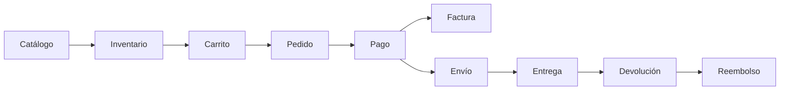

# NexusMarket — Backend

[](https://github.com/CamiloCT3105/nexusmarket-backend/actions/workflows/ci.yml)

API REST de **NexusMarket**, un marketplace que conecta compradores y vendedores. Cubre el ciclo completo de una compra (catálogo, inventario, carrito, pedido, pago, facturación, logística, devoluciones y reembolsos), con control de acceso por roles y reportes administrativos.

Proyecto académico desarrollado con **desarrollo asistido por IA (vibe coding)**. El documento de negocio, los casos de uso, las decisiones técnicas y la bitácora del proceso están en la carpeta [`SDD/`](./SDD).

## Tabla de contenido

- [Stack tecnológico](#stack-tecnológico)
- [Requisitos](#requisitos)
- [Instalación y ejecución](#instalación-y-ejecución)
- [Variables de entorno](#variables-de-entorno)
- [Scripts](#scripts)
- [Despliegue](#despliegue)
- [Estructura del proyecto](#estructura-del-proyecto)
- [Autenticación y uso rápido](#autenticación-y-uso-rápido)
- [Flujo de negocio](#flujo-de-negocio)
- [Roles](#roles)
- [Endpoints](#endpoints)
- [Documentación](#documentación)
- [Limitaciones conocidas](#limitaciones-conocidas)
- [Próximos pasos](#próximos-pasos)
- [Licencia](#licencia)

## Stack tecnológico

| Tecnología | Uso |
|---|---|
| Node.js | Entorno de ejecución |
| TypeScript 5.x | Lenguaje (modo estricto) |
| Express 5 | Framework web |
| jsonwebtoken | Tokens JWT de autenticación |
| `crypto` (`scrypt`) | Hash de contraseñas (incluido en Node) |
| dotenv | Variables de entorno |
| ts-node-dev | Recarga automática en desarrollo |
| PostgreSQL 17 | Datos transaccionales (usuarios, inventario, pedidos, facturación, posventa) |
| Prisma 7 | ORM y migraciones de PostgreSQL |
| MongoDB 8 | Catálogo de productos, carritos y bitácora de movimientos |
| Mongoose 9 | ODM de MongoDB (esquemas e índices) |
| Docker Compose | Levanta ambas bases de datos en desarrollo |

## Requisitos

- Node.js 20 o superior
- npm
- Docker Desktop (para PostgreSQL y MongoDB)

## Instalación y ejecución

```bash
# 1. Clonar el repositorio
git clone https://github.com/CamiloCT3105/nexusmarket-backend.git
cd nexusmarket-backend

# 2. Instalar dependencias (también genera el cliente de Prisma)
npm install

# 3. Crear el archivo de entorno a partir del ejemplo
cp .env.example .env        # en Windows (cmd): copy .env.example .env

# 4. Generar un secreto para firmar los tokens y pegarlo en .env como JWT_SECRET
node -e "console.log(require('crypto').randomBytes(32).toString('hex'))"

# 5. Levantar PostgreSQL y MongoDB (con Docker Desktop abierto)
npm run db:up

# 6. Crear las tablas en PostgreSQL
npm run db:migrate

# 7. Levantar el servidor en modo desarrollo
npm run dev
```

Verifica que funciona abriendo `http://localhost:3000/health`, que debe responder `{ "status": "ok" }`. Si PostgreSQL no está disponible, el servidor no arranca y lo indica en la consola.

> **Persistencia:** lo transaccional (usuarios, perfiles, bodegas, inventario, pedidos, facturas, envíos, devoluciones y reembolsos) vive en **PostgreSQL**; el catálogo de productos, los carritos y la bitácora de movimientos, en **MongoDB**. Todo sobrevive a los reinicios. Si alguna de las dos bases no está disponible, el servidor no arranca.

MongoDB se publica en el puerto **27018** del equipo (no en el 27017 habitual) para no chocar con un MongoDB instalado localmente.

## Variables de entorno

| Variable | Obligatoria | Descripción | Valor por defecto |
|---|:--:|---|---|
| `PORT` | No | Puerto del servidor. | `3000` |
| `NODE_ENV` | No | Entorno de ejecución. | `development` |
| `JWT_SECRET` | **Sí** | Secreto para firmar los tokens. Si falta, el servidor no arranca. | — |
| `JWT_EXPIRES_IN_SECONDS` | No | Duración del token en segundos. | `28800` (8 horas) |
| `ADMIN_EMAIL` | Recomendada | Correo del administrador que se crea al arrancar. | — |
| `ADMIN_PASSWORD` | Recomendada | Contraseña de ese administrador (mínimo 8 caracteres). | — |
| `ADMIN_DOCUMENT_NUMBER` | Recomendada | Documento de identidad de ese administrador (único). Si el administrador ya existía con un documento temporal (`PENDIENTE-…`), se le asigna este al arrancar. | — |
| `CORS_ORIGIN` | No | Frontends que pueden llamar a la API desde el navegador, separados por coma. | `http://localhost:5173` (Vite) |
| `DATABASE_URL` | **Sí** | Conexión a PostgreSQL. Si falta, el servidor no arranca. | ver `.env.example` |
| `MONGO_URL` | **Sí** | Conexión a MongoDB. Si falta, el servidor no arranca. | ver `.env.example` |
| `TRUST_PROXY` | No | Proxies de confianza delante de la API, para conocer la IP real del cliente. `3` en Render (Cloudflare y su balanceador van delante); vacío en local. | vacío (ninguno) |
| `RATE_LIMIT_LOGIN_PER_ACCOUNT` | No | Intentos fallidos de login por IP y correo en 15 minutos. | `10` |
| `RATE_LIMIT_LOGIN_PER_IP` | No | Intentos fallidos de login por IP en 15 minutos. | `100` |
| `RATE_LIMIT_REGISTER_PER_IP` | No | Cuentas nuevas por IP en una hora. | `30` |

Si `ADMIN_EMAIL`, `ADMIN_PASSWORD` o `ADMIN_DOCUMENT_NUMBER` no están definidos, no se crea ningún administrador y no habrá forma de crear vendedores ni otros roles.

**El archivo `.env` nunca debe subirse a GitHub.** Con el `JWT_SECRET` cualquiera podría fabricar tokens válidos. El repositorio incluye `.env.example` como plantilla, sin valores reales.

## Scripts

| Comando | Qué hace |
|---|---|
| `npm run dev` | Levanta el servidor con recarga automática. |
| `npm run build` | Genera el cliente de Prisma y compila TypeScript a `dist/`. |
| `npm start` | Ejecuta la versión compilada (`dist/index.js`). |
| `npm run db:up` | Levanta PostgreSQL y MongoDB con Docker y espera a que estén listos. |
| `npm run db:down` | Detiene los contenedores (los datos se conservan). Para borrarlos: `docker compose down -v`. |
| `npm run db:migrate` | Crea o aplica migraciones en desarrollo (`prisma migrate dev`). |
| `npm run db:deploy` | Aplica migraciones pendientes sin crear nuevas (producción). |
| `npm run db:studio` | Abre Prisma Studio para ver y editar los datos en el navegador. |
| `npm test` | Ejecuta las pruebas de punta a punta (ver abajo). |
| `npm run seed:demo` | Carga datos de demostración a través de la API (ver [Despliegue](#despliegue)). |

## Despliegue

La plataforma se publica con planes gratuitos: backend en **Render** (configurado con [`render.yaml`](./render.yaml)), PostgreSQL en **Neon**, MongoDB en **Atlas** y el frontend en **Vercel**. La guía paso a paso, con la carga de datos de demostración y los problemas comunes, está en [`DEPLOY.md`](./DEPLOY.md).

## Pruebas

```bash
npm test
```

Corre más de 300 comprobaciones de punta a punta contra un servidor real y bases de datos reales: flujo completo de compra, dirección de entrega y estado comercial, concurrencia (sobreventa, deadlocks, doble despacho), posventa, reportes con cifras exactas, catálogo y listados por rol, CORS, persistencia tras reiniciar y endurecimiento de la API (encabezados de seguridad, tamaño del cuerpo y límites de intentos).

- Requiere Docker con las bases levantadas (`npm run db:up`).
- Usa **bases de prueba separadas** (`nexusmarket_e2e`), que se vacían al empezar: tus datos de desarrollo no se tocan. El runner se niega a correr si el nombre de la base no contiene `e2e` o `test`.
- Cualquier error `500` inesperado en el servidor cuenta como fallo.
- Las suites están en [`tests/e2e/`](./tests/e2e).

**Integración continua.** Cada PR y cada cambio en `main` corre en GitHub Actions ([`ci.yml`](./.github/workflows/ci.yml)) con PostgreSQL y MongoDB desechables:

1. Compilación con el mismo comando que Render (`npm run build`).
2. Migraciones aplicadas desde cero y comparadas con `schema.prisma`: si alguien cambia el esquema sin crear la migración, falla.
3. `npm test` completo.
4. `npm run seed:demo` dos veces: los datos de demostración se cargan y la segunda vez no modifican nada.

## Estructura del proyecto

```
nexusmarket-backend/
├── SDD/                     # Documentación y bitácora del desarrollo asistido por IA
├── prisma/
│   ├── schema.prisma        # Esquema relacional (PostgreSQL)
│   └── migrations/          # Migraciones SQL versionadas
├── src/
│   ├── config/              # Variables de entorno
│   ├── controllers/         # Adaptan HTTP a los servicios; verifican propiedad del recurso
│   ├── db/                  # Cliente de Prisma, transacciones y errores de base de datos
│   ├── errors/              # Errores tipados (cada uno con su código HTTP)
│   ├── middlewares/         # authenticate · authorize · ownerOrRoles · errorHandler
│   ├── models/              # Interfaces y enums de cada entidad
│   ├── generated/           # Cliente de Prisma generado (no se sube a git)
│   ├── repositories/        # Acceso a datos asíncrono (PostgreSQL o MongoDB)
│   ├── routes/              # Endpoints y permisos por rol
│   ├── services/            # Lógica de negocio
│   ├── utils/               # Hash de contraseñas, JWT y lectura de parámetros
│   ├── app.ts               # Configuración de Express
│   └── index.ts             # Punto de entrada
├── .env.example
├── docker-compose.yml       # PostgreSQL + MongoDB para desarrollo
├── prisma.config.ts         # Configuración de la CLI de Prisma
├── LICENSE
├── package.json
├── tsconfig.json
└── README.md
```

Cada petición sigue el recorrido **ruta → controller → servicio → repositorio**. El detalle de la arquitectura y las decisiones está en [`SDD/02-arquitectura-y-decisiones.md`](./SDD/02-arquitectura-y-decisiones.md).

## Autenticación y uso rápido

Todo lo que hay bajo `/api` exige un token, excepto el registro y el login. El token se envía en el header `Authorization: Bearer <token>`.

**1. Iniciar sesión como administrador** (con los datos de tu `.env`):

```bash
curl -X POST http://localhost:3000/api/auth/login \
  -H "Content-Type: application/json" \
  -d '{"email":"admin@nexusmarket.com","password":"TU_ADMIN_PASSWORD"}'
```

La respuesta incluye un `token`.

**2. Usar el token** para crear, por ejemplo, un vendedor:

```bash
curl -X POST http://localhost:3000/api/users \
  -H "Authorization: Bearer TU_TOKEN" \
  -H "Content-Type: application/json" \
  -d '{"fullName":"Laura Vendedora","email":"laura@example.com","documentNumber":"1020304050","password":"clave12345","role":"SELLER"}'
```

> En Windows PowerShell, `curl` es un alias de otro comando; usa `curl.exe`, o mejor una herramienta como Postman o Thunder Client.

**Cómo se crean las cuentas:**

- El **registro público** (`POST /api/auth/register`) siempre crea un **comprador**.
- Los demás roles (vendedor, operador logístico, supervisor, administrador) los crea un **administrador** con `POST /api/users`.
- Un usuario `SELLER` debe además ser **incorporado como vendedor** (`POST /api/sellers`) antes de poder crear productos.
- Un usuario `BUYER` debe crear su **perfil de comprador** (`POST /api/buyers`) antes de usar carrito y pedidos.

## Flujo de negocio



Estados del pedido: `PENDING_PAYMENT → PAID → SHIPPED → DELIVERED`. Un pedido entregado es inmutable. Los diagramas de estado de envío, devolución y reembolso están en [`SDD/02`](./SDD/02-arquitectura-y-decisiones.md#5-máquinas-de-estado).

## Roles

| Rol | Qué puede hacer |
|---|---|
| `BUYER` (Comprador) | Gestionar su perfil, carrito y pedidos; pagar; consultar facturas y envíos; solicitar devoluciones. |
| `SELLER` (Vendedor) | Gestionar sus productos, bodegas e inventario; procesar devoluciones de sus productos. |
| `LOGISTICS_OPERATOR` (Operador Logístico) | Crear envíos y actualizar su seguimiento. |
| `ADMIN` (Administrador) | Administrar usuarios, vendedores, facturas y reembolsos; acceso a la supervisión. |
| `SUPERVISOR` (Supervisor) | Consultar información y reportes administrativos (solo lectura). |

La matriz completa por acción está en [`SDD/04-reglas-de-negocio-y-permisos.md`](./SDD/04-reglas-de-negocio-y-permisos.md#3-matriz-de-permisos-por-rol).

## Endpoints

Todas las rutas van bajo `/api`. Las columnas de acceso indican el rol necesario; "propio" significa que solo puede operar sobre sus propios datos.

### Autenticación — `/api/auth`

| Método | Ruta | Acceso |
|---|---|---|
| POST | `/register` | Público (crea un comprador). Body: `fullName`, `email`, `documentNumber`, `password` |
| POST | `/login` | Público |
| GET | `/me` | Autenticado |

### Usuarios — `/api/users`

| Método | Ruta | Acceso |
|---|---|---|
| POST | `/` | Admin |
| GET | `/:id` | Propio, Admin, Supervisor |
| GET | `/` | Admin, Supervisor — listado con `?role=&status=&search=` (nombre, correo o documento) |
| PATCH | `/:id/status` | Admin |
| PATCH | `/:id/role` | Admin |

### Compradores — `/api/buyers`

| Método | Ruta | Acceso |
|---|---|---|
| POST | `/` | Comprador |
| GET | `/:userId` | Propio, Admin, Supervisor |
| PATCH | `/:userId/addresses` | Propio |
| PATCH | `/:userId/commercial-status` | Admin |

### Vendedores — `/api/sellers`

| Método | Ruta | Acceso |
|---|---|---|
| POST | `/` | Admin |
| GET | `/:userId` | Propio, Admin, Supervisor |
| PATCH | `/:userId/warehouses` | Admin |

### Productos — `/api/products`

| Método | Ruta | Acceso |
|---|---|---|
| POST | `/` | Vendedor |
| GET | `/:id` | Autenticado |
| GET | `/` | Autenticado — **catálogo**: `?search=&type=&sellerId=&minPrice=&maxPrice=&status=&sort=` (`newest`, `price_asc`, `price_desc`, `name_asc`). El comprador y el operador logístico ven solo publicados; el vendedor, además, los suyos en cualquier estado; supervisor y admin, todos |
| GET | `/seller/:sellerId` | Autenticado |
| PATCH | `/:id/variants` | Vendedor (propio), Admin |
| PATCH | `/:id/status` | Vendedor (propio), Admin |

### Bodegas — `/api/warehouses`

| Método | Ruta | Acceso |
|---|---|---|
| POST | `/` | Vendedor (propia), Admin |
| GET | `/` | Operador Logístico, Supervisor, Admin — `?type=&sellerId=` |
| GET | `/:id` | Vendedor (propia), Operador Logístico, Supervisor, Admin |
| GET | `/seller/:sellerId` | Propio, Operador Logístico, Supervisor, Admin |
| PATCH | `/:id/link-seller` | Admin |

### Inventario — `/api/inventory`

| Método | Ruta | Acceso |
|---|---|---|
| GET | `/` | Vendedor (solo sus bodegas), Operador Logístico, Supervisor, Admin — `?productId=&warehouseId=` |
| POST | `/inbound` | Vendedor (bodega propia), Operador Logístico, Admin |
| POST | `/damaged` | Vendedor (bodega propia), Operador Logístico, Admin |
| POST | `/reserve` | Admin (operación interna) |
| POST | `/outbound` | Admin (operación interna) |
| POST | `/return` | Admin (operación interna) |
| GET | `/:productId/:warehouseId` | Vendedor (bodega propia), Operador Logístico, Supervisor, Admin |

### Carrito — `/api/carts`

| Método | Ruta | Acceso |
|---|---|---|
| GET | `/:buyerId` | Solo el dueño |
| POST | `/:buyerId/items` | Solo el dueño |
| PATCH | `/:buyerId/items/:productId` | Solo el dueño |
| DELETE | `/:buyerId/items/:productId` | Solo el dueño |

### Pedidos — `/api/orders`

| Método | Ruta | Acceso |
|---|---|---|
| POST | `/checkout` | Comprador con estado comercial `ACTIVE` — `{ addressIndex? }` elige la dirección de entrega (0 = principal); el pedido guarda una copia (`shippingAddress`) |
| GET | `/` | Todos — `?status=&buyerId=&from=&to=`. Comprador: los suyos; **vendedor: los que incluyen sus productos, solo con sus líneas y `sellerSubtotal`**; operador, supervisor y admin: todos |
| GET | `/buyer/:buyerId` | Propio, Admin, Supervisor |
| GET | `/:id` | Comprador (propio), Vendedor (solo sus líneas, sin dirección de entrega), Operador Logístico, Supervisor, Admin |
| POST | `/:id/pay` | Comprador (propio) |
| PATCH | `/:id/status` | Admin |

### Facturas — `/api/invoices`

| Método | Ruta | Acceso |
|---|---|---|
| POST | `/` | Admin |
| GET | `/:id` | Comprador (propia), Supervisor, Admin |
| GET | `/` | Comprador (las suyas), Supervisor, Admin |
| GET | `/order/:orderId` | Comprador (propia), Supervisor, Admin |

### Envíos — `/api/shipments`

| Método | Ruta | Acceso |
|---|---|---|
| POST | `/` | Operador Logístico, Admin |
| GET | `/` | Operador Logístico, Supervisor, Admin — `?status=` |
| GET | `/:id` | Comprador (propio), Operador Logístico, Supervisor, Admin |
| GET | `/order/:orderId` | Comprador (propio), Operador Logístico, Supervisor, Admin |
| PATCH | `/:id/status` | Operador Logístico, Admin |

### Devoluciones — `/api/returns`

| Método | Ruta | Acceso |
|---|---|---|
| POST | `/` | Comprador |
| GET | `/:id` | Comprador (propia), Vendedor (de sus productos), Supervisor, Admin |
| GET | `/` | Comprador (de sus pedidos), Vendedor (de sus productos), Supervisor, Admin — `?status=` |
| GET | `/order/:orderId` | Comprador (propio), Supervisor, Admin |
| PATCH | `/:id/process` | Vendedor (de sus productos), Admin |

### Reembolsos — `/api/refunds`

| Método | Ruta | Acceso |
|---|---|---|
| GET | `/` | Comprador (los suyos), Supervisor, Admin — `?status=` |
| GET | `/:id` | Comprador (propio), Supervisor, Admin |
| GET | `/return/:returnId` | Comprador (propio), Supervisor, Admin |
| PATCH | `/:id/status` | Admin |

### Reportes — `/api/reports`

Solo lectura. Acceso: Supervisor y Admin.

| Método | Ruta | Contenido |
|---|---|---|
| GET | `/summary` | Resumen general de la plataforma |
| GET | `/sales` | Ventas e ingresos. Parámetros opcionales `from` y `to` (`AAAA-MM-DD`) |
| GET | `/inventory` | Existencias con alerta de stock bajo. Parámetro opcional `threshold` |
| GET | `/logistics` | Envíos por estado y pedidos pendientes de envío |
| GET | `/returns` | Devoluciones y reembolsos |

> Los listados (`GET /` de cada módulo) aceptan `?page=` y `?pageSize=` (máximo 100) y responden `{ items, page, pageSize, total, totalPages }`. Cada rol solo ve lo que le corresponde.

### Códigos de respuesta

| Código | Significado |
|---|---|
| `200` / `201` | Operación exitosa / recurso creado |
| `400` | Datos inválidos o regla de negocio incumplida |
| `401` | Sin token, token inválido o vencido, o credenciales incorrectas |
| `403` | Autenticado, pero sin permiso (rol o propiedad) |
| `404` | Recurso o ruta no encontrados |
| `409` | Conflicto: el recurso ya existe (correo registrado, perfil, factura o envío duplicados) |
| `500` | Error inesperado del servidor (el detalle solo se registra en la consola) |

Los errores devuelven un cuerpo `{ "message": "..." }`. Todos pasan por un único middleware central (`src/middlewares/errorHandler.ts`).

## Documentación

Todo el detalle funcional y técnico está en [`SDD/`](./SDD):

| Documento | Contenido |
|---|---|
| [`01-especificacion-funcional.md`](./SDD/01-especificacion-funcional.md) | Documento de negocio original |
| [`02-arquitectura-y-decisiones.md`](./SDD/02-arquitectura-y-decisiones.md) | Arquitectura, máquinas de estado y decisiones técnicas |
| [`03-casos-de-uso.md`](./SDD/03-casos-de-uso.md) | Los 39 casos de uso implementados |
| [`04-reglas-de-negocio-y-permisos.md`](./SDD/04-reglas-de-negocio-y-permisos.md) | Reglas numeradas y matriz de permisos |
| [`05-bitacora-vibe-coding.md`](./SDD/05-bitacora-vibe-coding.md) | Metodología, orden de construcción y problemas resueltos |

## Limitaciones conocidas

Este proyecto es una base funcional, no un sistema listo para producción:

- **Sin transacciones entre PostgreSQL y MongoDB**: la bitácora de movimientos se escribe justo después de confirmar en PostgreSQL; si MongoDB fallara en ese instante, el movimiento se perdería.
- El **pago es simulado**: solo cambia el estado del pedido.
- **Productos digitales**: pasan por inventario y envío como los físicos (la especificación pide entrega inmediata tras el pago; queda para una fase posterior).
- La **validación de entradas** se hace a mano en los servicios, sin una librería de esquemas.
- Los **límites de intentos de login y registro** viven en memoria: se reinician en cada despliegue y no se comparten entre instancias.
- El dinero se maneja como `number`; en producción conviene usar enteros en centavos.

La lista completa está en [`SDD/02`](./SDD/02-arquitectura-y-decisiones.md#8-limitaciones-conocidas).

## Próximos pasos

- [x] Infraestructura de bases de datos (Docker, PostgreSQL + Prisma, esquema y migración inicial)
- [x] Usuarios y credenciales en PostgreSQL
- [x] Compradores (con direcciones), vendedores y bodegas en PostgreSQL
- [x] Inventario y pedidos en PostgreSQL, con checkout transaccional y a prueba de sobreventa
- [x] Facturas, envíos, devoluciones y reembolsos en PostgreSQL (transaccionales); reportes con consultas SQL agregadas
- [x] Catálogo, carritos y movimientos de inventario en MongoDB
- [ ] Validación de entradas con una librería (por ejemplo, `zod`)
- [x] Pruebas automatizadas de punta a punta (`npm test`)
- [x] Preparación para el frontend: CORS, catálogo con filtros y listados paginados por rol
- [x] Documento de identidad único, operador logístico en inventario y pedidos visibles para el vendedor (brechas con la especificación)
- [x] Dirección de entrega en el pedido y estado comercial que bloquea compras (brechas con la especificación)
- [x] Frontend en React + TypeScript ([`nexusmarket-frontend`](https://github.com/CamiloCT3105/nexusmarket-frontend))
- [ ] Productos digitales con entrega inmediata tras el pago

## Licencia

Distribuido bajo licencia MIT. Consulta el archivo [`LICENSE`](./LICENSE).

---

Desarrollado por [@CamiloCT3105](https://github.com/CamiloCT3105).
