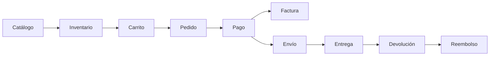

# NexusMarket Backend

[](https://github.com/CamiloCT3105/nexusmarket-backend/actions/workflows/ci.yml)

API REST de NexusMarket, un marketplace que intermedia entre compradores y vendedores. Gestiona el ciclo completo de una compra (catálogo, inventario, carrito, pedido, pago, facturación, logística, devoluciones y reembolsos) con control de acceso por roles y reportes administrativos.

La interfaz web se encuentra en el repositorio [nexusmarket-frontend](https://github.com/CamiloCT3105/nexusmarket-frontend). La documentación de análisis y diseño (especificación, casos de uso, reglas de negocio, decisiones técnicas y bitácora del proceso) está en la carpeta [`SDD/`](./SDD).

**Demo:** [nexusmarket-frontend.vercel.app](https://nexusmarket-frontend.vercel.app) · **Estado de la API:** [nexusmarket-api.onrender.com/health](https://nexusmarket-api.onrender.com/health)

> La API se ejecuta en un plan gratuito que se suspende tras 15 minutos de inactividad. La primera petición posterior puede tardar alrededor de un minuto.

## Contenido

- [Tecnologías](#tecnologías)
- [Requisitos](#requisitos)
- [Instalación](#instalación)
- [Variables de entorno](#variables-de-entorno)
- [Scripts](#scripts)
- [Pruebas](#pruebas)
- [Despliegue](#despliegue)
- [Arquitectura](#arquitectura)
- [Autenticación](#autenticación)
- [Flujo de negocio y roles](#flujo-de-negocio-y-roles)
- [Endpoints](#endpoints)
- [Seguridad](#seguridad)
- [Limitaciones conocidas](#limitaciones-conocidas)
- [Hoja de ruta](#hoja-de-ruta)
- [Licencia](#licencia)

## Tecnologías

| Tecnología | Uso |
|---|---|
| Node.js y TypeScript 5 (modo estricto) | Entorno de ejecución y lenguaje |
| Express 5 | Servidor HTTP |
| PostgreSQL 17 y Prisma 7 | Datos transaccionales y migraciones |
| MongoDB 8 y Mongoose 9 | Catálogo de productos, carritos y bitácora de movimientos |
| jsonwebtoken y `crypto.scrypt` | Autenticación con JWT y hash de contraseñas |
| helmet y express-rate-limit | Encabezados de seguridad y límite de intentos |
| Docker Compose | Bases de datos para desarrollo local |
| GitHub Actions | Integración continua |

## Requisitos

- Node.js 22.12 o superior.
- npm.
- Docker Desktop, para ejecutar PostgreSQL y MongoDB en local.

## Instalación

```bash
# 1. Clonar el repositorio
git clone https://github.com/CamiloCT3105/nexusmarket-backend.git
cd nexusmarket-backend

# 2. Instalar dependencias (genera también el cliente de Prisma)
npm install

# 3. Crear el archivo de entorno a partir de la plantilla
cp .env.example .env        # Windows (cmd): copy .env.example .env

# 4. Generar un secreto para los tokens y asignarlo a JWT_SECRET en .env
node -e "console.log(require('crypto').randomBytes(32).toString('hex'))"

# 5. Iniciar PostgreSQL y MongoDB (requiere Docker Desktop en ejecución)
npm run db:up

# 6. Aplicar las migraciones
npm run db:migrate

# 7. Iniciar el servidor en modo desarrollo
npm run dev
```

El servidor queda disponible en `http://localhost:3000`, y `GET /health` responde `{ "status": "ok" }`. Si alguna de las dos bases de datos no está disponible, el servidor no inicia e informa la causa en la consola.

MongoDB se publica en el puerto 27018 del equipo, en lugar del 27017, para no entrar en conflicto con una instalación local.

## Variables de entorno

| Variable | Obligatoria | Descripción | Valor por defecto |
|---|:--:|---|---|
| `PORT` | No | Puerto del servidor. | `3000` |
| `NODE_ENV` | No | Entorno de ejecución. | `development` |
| `JWT_SECRET` | Sí | Secreto con el que se firman los tokens. | — |
| `JWT_EXPIRES_IN_SECONDS` | No | Vigencia del token, en segundos. | `28800` (8 horas) |
| `DATABASE_URL` | Sí | Cadena de conexión a PostgreSQL. | Ver `.env.example` |
| `MONGO_URL` | Sí | Cadena de conexión a MongoDB. | Ver `.env.example` |
| `CORS_ORIGIN` | No | Orígenes autorizados a consumir la API desde el navegador, separados por coma. | `http://localhost:5173` |
| `ADMIN_EMAIL` | Recomendada | Correo del administrador que se crea al iniciar. | — |
| `ADMIN_PASSWORD` | Recomendada | Contraseña de ese administrador (mínimo 8 caracteres). | — |
| `ADMIN_DOCUMENT_NUMBER` | Recomendada | Documento de identidad de ese administrador. | — |
| `TRUST_PROXY` | No | Número de proxies delante de la API, para obtener la IP real del cliente. En Render es `3`; en local se deja vacío. | Vacío |
| `RATE_LIMIT_LOGIN_PER_ACCOUNT` | No | Intentos fallidos de inicio de sesión por IP y correo cada 15 minutos. | `10` |
| `RATE_LIMIT_LOGIN_PER_IP` | No | Intentos fallidos de inicio de sesión por IP cada 15 minutos. | `100` |
| `RATE_LIMIT_REGISTER_PER_IP` | No | Registros por IP cada hora. | `30` |

Sin `ADMIN_EMAIL`, `ADMIN_PASSWORD` y `ADMIN_DOCUMENT_NUMBER` no se crea el administrador inicial, y sin él no es posible crear vendedores ni otros roles.

El archivo `.env` contiene secretos y está excluido del repositorio. La plantilla `.env.example` no contiene valores reales.

## Scripts

| Comando | Descripción |
|---|---|
| `npm run dev` | Inicia el servidor con recarga automática. |
| `npm run build` | Genera el cliente de Prisma y compila a `dist/`. |
| `npm start` | Ejecuta la versión compilada. |
| `npm run db:up` | Inicia PostgreSQL y MongoDB con Docker y espera a que estén disponibles. |
| `npm run db:down` | Detiene los contenedores y conserva los datos (`docker compose down -v` los elimina). |
| `npm run db:migrate` | Crea o aplica migraciones en desarrollo. |
| `npm run db:deploy` | Aplica las migraciones pendientes, sin crear nuevas. |
| `npm run db:studio` | Abre Prisma Studio para consultar los datos. |
| `npm test` | Ejecuta las pruebas de punta a punta. |
| `npm run seed:demo` | Carga datos de demostración a través de la API. |

## Pruebas

```bash
npm test
```

La suite ejecuta más de 400 comprobaciones de punta a punta contra un servidor y bases de datos reales. Cubre el flujo completo de compra, la dirección de entrega y el estado comercial, la concurrencia (sobreventa, interbloqueos y doble despacho), la posventa, los reportes con cifras exactas, la visibilidad por rol, CORS, las fotos de producto, la persistencia tras un reinicio y el endurecimiento de la API.

- Requiere las bases de datos en ejecución (`npm run db:up`).
- Utiliza bases separadas (`nexusmarket_e2e`) que se vacían al comenzar, de modo que los datos de desarrollo no se modifican. Por seguridad, la ejecución se cancela si el nombre de la base no contiene `e2e` o `test`.
- Cualquier error `500` inesperado del servidor se considera un fallo.
- Las suites se encuentran en [`tests/e2e/`](./tests/e2e).

### Integración continua

Cada pull request y cada cambio en `main` se validan en GitHub Actions ([`ci.yml`](./.github/workflows/ci.yml)) con PostgreSQL y MongoDB efímeros:

1. Compilación con el mismo comando que se usa en producción.
2. Verificación de que las migraciones reproducen exactamente `schema.prisma`.
3. Suite completa de pruebas.
4. Carga de los datos de demostración dos veces, para comprobar que el script es idempotente.

## Despliegue

La plataforma se publica con servicios en plan gratuito: la API en Render (configurada en [`render.yaml`](./render.yaml)), PostgreSQL en Neon, MongoDB en Atlas y el frontend en Vercel. El procedimiento completo, incluida la carga de datos de demostración, se describe en [`DEPLOY.md`](./DEPLOY.md).

## Arquitectura

Cada petición recorre las capas **ruta → controlador → servicio → repositorio**. Las reglas de negocio se concentran en los servicios; los repositorios aíslan el acceso a datos, por lo que cada módulo puede usar PostgreSQL o MongoDB sin afectar la lógica.

La persistencia es políglota:

- **PostgreSQL:** usuarios, perfiles, bodegas, inventario, pedidos, facturas, envíos, devoluciones y reembolsos. Las operaciones que afectan varias tablas, como el checkout, se ejecutan en una transacción.
- **MongoDB:** catálogo de productos (con variantes flexibles), carritos con expiración automática y bitácora de movimientos de inventario.

```
nexusmarket-backend/
├── .github/workflows/    Integración continua
├── SDD/                  Documentación de análisis y diseño
├── prisma/               Esquema relacional y migraciones
├── scripts/              Datos de demostración y créditos de imágenes
├── src/
│   ├── config/           Variables de entorno
│   ├── controllers/      Adaptación HTTP y verificación de propiedad
│   ├── db/               Conexiones, transacciones y modelos de MongoDB
│   ├── errors/           Errores de dominio con su código HTTP
│   ├── middlewares/      Autenticación, autorización, límites y errores
│   ├── models/           Entidades y enumeraciones
│   ├── repositories/     Acceso a datos
│   ├── routes/           Endpoints y permisos por rol
│   ├── services/         Reglas de negocio
│   └── utils/            Contraseñas, JWT y parámetros
├── tests/e2e/            Pruebas de punta a punta
├── DEPLOY.md             Guía de despliegue
└── render.yaml           Configuración del servicio en Render
```

El detalle de la arquitectura, las máquinas de estado y las decisiones técnicas se documenta en [`SDD/02-arquitectura-y-decisiones.md`](./SDD/02-arquitectura-y-decisiones.md).

## Autenticación

Todas las rutas bajo `/api` requieren un token, excepto el registro y el inicio de sesión. El token se envía en el encabezado `Authorization: Bearer <token>`.

Inicio de sesión:

```bash
curl -X POST http://localhost:3000/api/auth/login \
  -H "Content-Type: application/json" \
  -d '{"email":"<ADMIN_EMAIL>","password":"<ADMIN_PASSWORD>"}'
```

Uso del token, por ejemplo para crear un vendedor:

```bash
curl -X POST http://localhost:3000/api/users \
  -H "Authorization: Bearer <token>" \
  -H "Content-Type: application/json" \
  -d '{"fullName":"Laura Gómez","email":"laura@example.com","documentNumber":"1020304050","password":"clave12345","role":"SELLER"}'
```

En Windows PowerShell debe usarse `curl.exe`, ya que `curl` es un alias de otro comando.

Creación de cuentas:

- El registro público (`POST /api/auth/register`) crea siempre un comprador.
- Los demás roles los crea un administrador con `POST /api/users`.
- Un vendedor debe ser habilitado (`POST /api/sellers`) antes de publicar productos.
- Un comprador debe crear su perfil con dirección (`POST /api/buyers`) antes de usar el carrito.

## Flujo de negocio y roles



Un pedido pasa por los estados `PENDING_PAYMENT → PAID → SHIPPED → DELIVERED`. Los diagramas de estado de envíos, devoluciones y reembolsos se encuentran en [`SDD/02`](./SDD/02-arquitectura-y-decisiones.md#5-máquinas-de-estado).

| Rol | Responsabilidades |
|---|---|
| Comprador (`BUYER`) | Perfil, carrito y pedidos; pago; consulta de facturas y envíos; solicitud de devoluciones. |
| Vendedor (`SELLER`) | Productos, bodegas e inventario; gestión de devoluciones de sus productos. |
| Operador logístico (`LOGISTICS_OPERATOR`) | Creación y seguimiento de envíos; inventario de todas las bodegas. |
| Administrador (`ADMIN`) | Usuarios, vendedores, facturación, reembolsos y moderación de productos. |
| Supervisor (`SUPERVISOR`) | Consulta de la operación y reportes, sin permisos de modificación. |

La matriz de permisos por acción se encuentra en [`SDD/04`](./SDD/04-reglas-de-negocio-y-permisos.md#3-matriz-de-permisos-por-rol).

## Endpoints

Todas las rutas se publican bajo `/api`. En la columna de acceso, "propio" indica que el usuario solo puede operar sobre sus propios datos.

### Autenticación: `/api/auth`

| Método | Ruta | Acceso |
|---|---|---|
| POST | `/register` | Público. Crea un comprador (`fullName`, `email`, `documentNumber`, `password`). |
| POST | `/login` | Público |
| GET | `/me` | Autenticado |

### Usuarios: `/api/users`

| Método | Ruta | Acceso |
|---|---|---|
| POST | `/` | Administrador |
| GET | `/` | Administrador, supervisor. Filtros: `role`, `status`, `search`. |
| GET | `/:id` | Propio, administrador, supervisor |
| PATCH | `/:id/status` | Administrador |
| PATCH | `/:id/role` | Administrador |

### Compradores: `/api/buyers`

| Método | Ruta | Acceso |
|---|---|---|
| POST | `/` | Comprador |
| GET | `/:userId` | Propio, administrador, supervisor |
| PATCH | `/:userId/addresses` | Propio |
| PATCH | `/:userId/commercial-status` | Administrador |

### Vendedores: `/api/sellers`

| Método | Ruta | Acceso |
|---|---|---|
| POST | `/` | Administrador |
| GET | `/:userId` | Propio, administrador, supervisor |
| PATCH | `/:userId/warehouses` | Administrador |

### Productos: `/api/products`

| Método | Ruta | Acceso |
|---|---|---|
| POST | `/` | Vendedor |
| GET | `/` | Autenticado. Catálogo con filtros `search`, `type`, `sellerId`, `minPrice`, `maxPrice`, `status` y orden `sort` (`newest`, `price_asc`, `price_desc`, `name_asc`). Compradores y operadores ven solo productos publicados; el vendedor ve además los suyos. |
| GET | `/:id` | Autenticado |
| GET | `/seller/:sellerId` | Autenticado |
| PATCH | `/:id/variants` | Vendedor (propio), administrador |
| PATCH | `/:id/status` | Vendedor (propio), administrador |
| PATCH | `/:id/image` | Vendedor (propio), administrador. `{ "imageUrl": "https://..." }`, o `null` para quitarla. |

### Bodegas: `/api/warehouses`

| Método | Ruta | Acceso |
|---|---|---|
| POST | `/` | Vendedor (propia), administrador |
| GET | `/` | Operador logístico, supervisor, administrador. Filtros: `type`, `sellerId`. |
| GET | `/:id` | Vendedor (propia), operador logístico, supervisor, administrador |
| GET | `/seller/:sellerId` | Propio, operador logístico, supervisor, administrador |
| PATCH | `/:id/link-seller` | Administrador |

### Inventario: `/api/inventory`

| Método | Ruta | Acceso |
|---|---|---|
| GET | `/` | Vendedor (sus bodegas), operador logístico, supervisor, administrador. Filtros: `productId`, `warehouseId`. |
| GET | `/:productId/:warehouseId` | Vendedor (bodega propia), operador logístico, supervisor, administrador |
| POST | `/inbound` | Vendedor (bodega propia), operador logístico, administrador |
| POST | `/damaged` | Vendedor (bodega propia), operador logístico, administrador |
| POST | `/reserve`, `/outbound`, `/return` | Administrador (operaciones internas) |

### Carrito: `/api/carts`

| Método | Ruta | Acceso |
|---|---|---|
| GET | `/:buyerId` | Propio |
| POST | `/:buyerId/items` | Propio |
| PATCH | `/:buyerId/items/:productId` | Propio |
| DELETE | `/:buyerId/items/:productId` | Propio |

### Pedidos: `/api/orders`

| Método | Ruta | Acceso |
|---|---|---|
| POST | `/checkout` | Comprador con estado comercial activo. `addressIndex` opcional selecciona la dirección de entrega (0 = principal). |
| GET | `/` | Autenticado. Filtros: `status`, `buyerId`, `from`, `to`. El comprador ve los suyos; el vendedor, solo sus líneas y su subtotal. |
| GET | `/buyer/:buyerId` | Propio, administrador, supervisor |
| GET | `/:id` | Comprador (propio), vendedor (sus líneas), operador logístico, supervisor, administrador |
| POST | `/:id/pay` | Comprador (propio) |
| PATCH | `/:id/status` | Administrador |

### Facturas: `/api/invoices`

| Método | Ruta | Acceso |
|---|---|---|
| POST | `/` | Administrador |
| GET | `/` | Comprador (las suyas), supervisor, administrador |
| GET | `/:id` | Comprador (propia), supervisor, administrador |
| GET | `/order/:orderId` | Comprador (propia), supervisor, administrador |

### Envíos: `/api/shipments`

| Método | Ruta | Acceso |
|---|---|---|
| POST | `/` | Operador logístico, administrador |
| GET | `/` | Operador logístico, supervisor, administrador. Filtro: `status`. |
| GET | `/:id` | Comprador (propio), operador logístico, supervisor, administrador |
| GET | `/order/:orderId` | Comprador (propio), operador logístico, supervisor, administrador |
| PATCH | `/:id/status` | Operador logístico, administrador |

### Devoluciones: `/api/returns`

| Método | Ruta | Acceso |
|---|---|---|
| POST | `/` | Comprador |
| GET | `/` | Comprador (sus pedidos), vendedor (sus productos), supervisor, administrador. Filtro: `status`. |
| GET | `/:id` | Comprador (propia), vendedor (sus productos), supervisor, administrador |
| GET | `/order/:orderId` | Comprador (propio), supervisor, administrador |
| PATCH | `/:id/process` | Vendedor (sus productos), administrador |

### Reembolsos: `/api/refunds`

| Método | Ruta | Acceso |
|---|---|---|
| GET | `/` | Comprador (los suyos), supervisor, administrador. Filtro: `status`. |
| GET | `/:id` | Comprador (propio), supervisor, administrador |
| GET | `/return/:returnId` | Comprador (propio), supervisor, administrador |
| PATCH | `/:id/status` | Administrador |

### Reportes: `/api/reports`

Solo lectura, para supervisor y administrador.

| Método | Ruta | Contenido |
|---|---|---|
| GET | `/summary` | Resumen general de la plataforma |
| GET | `/sales` | Ventas e ingresos; parámetros opcionales `from` y `to` (`AAAA-MM-DD`) |
| GET | `/inventory` | Existencias con alerta de stock bajo; parámetro opcional `threshold` |
| GET | `/logistics` | Envíos por estado y pedidos pendientes de envío |
| GET | `/returns` | Devoluciones y reembolsos |

Los listados aceptan `page` y `pageSize` (máximo 100) y responden con el formato `{ items, page, pageSize, total, totalPages }`.

### Códigos de respuesta

| Código | Significado |
|---|---|
| `200` / `201` | Operación exitosa / recurso creado |
| `400` | Datos inválidos o regla de negocio incumplida |
| `401` | Token ausente, inválido o vencido, o credenciales incorrectas |
| `403` | Usuario autenticado sin permiso sobre el recurso |
| `404` | Recurso o ruta inexistente |
| `409` | Recurso duplicado |
| `413` | Cuerpo de la petición mayor a 100 kB |
| `429` | Límite de intentos superado |
| `500` | Error interno (el detalle solo se registra en el servidor) |

Los errores responden con el formato `{ "message": "..." }`.

## Seguridad

- Contraseñas almacenadas con `scrypt` y sal; nunca en texto plano.
- El rol se consulta en cada petición, de modo que un bloqueo o un cambio de rol surte efecto de inmediato.
- La identidad del usuario se toma siempre del token, nunca del cuerpo de la petición.
- Límite de intentos fallidos de inicio de sesión por cuenta y por IP, y de registros por IP.
- Encabezados de seguridad HTTP con helmet y tamaño máximo del cuerpo de 100 kB.
- CORS restringido a los orígenes configurados.

## Limitaciones conocidas

- No existen transacciones entre PostgreSQL y MongoDB: la bitácora de movimientos se escribe después de confirmar la operación en PostgreSQL.
- El pago es simulado y solo cambia el estado del pedido.
- Los productos digitales siguen el mismo flujo de inventario y envío que los físicos.
- La validación de entradas se implementa en los servicios, sin una librería de esquemas.
- Los contadores de intentos se mantienen en memoria y se reinician con cada despliegue.
- Los importes se manejan como `number`; un sistema en producción debería usar enteros en centavos.

La lista completa se encuentra en [`SDD/02`](./SDD/02-arquitectura-y-decisiones.md#8-limitaciones-conocidas).

## Hoja de ruta

- Validación de entradas con una librería de esquemas (por ejemplo, zod).
- Carga de fotos de producto a un almacenamiento de objetos (S3 o Cloudinary).
- Entrega inmediata de productos digitales tras el pago.
- Integración con una pasarela de pagos.

## Licencia

Distribuido bajo la licencia MIT. Ver [`LICENSE`](./LICENSE).

## Autor

[@CamiloCT3105](https://github.com/CamiloCT3105)
