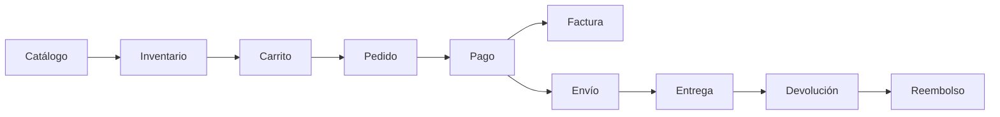

# NexusMarket — Backend

API REST de **NexusMarket**, un marketplace que conecta compradores y vendedores. Cubre el ciclo completo de una compra (catálogo, inventario, carrito, pedido, pago, facturación, logística, devoluciones y reembolsos), con control de acceso por roles y reportes administrativos.

Proyecto académico desarrollado con **desarrollo asistido por IA (vibe coding)**. El documento de negocio, los casos de uso, las decisiones técnicas y la bitácora del proceso están en la carpeta [`SDD/`](./SDD).

## Tabla de contenido

- [Stack tecnológico](#stack-tecnológico)
- [Requisitos](#requisitos)
- [Instalación y ejecución](#instalación-y-ejecución)
- [Variables de entorno](#variables-de-entorno)
- [Scripts](#scripts)
- [Estructura del proyecto](#estructura-del-proyecto)
- [Autenticación y uso rápido](#autenticación-y-uso-rápido)
- [Flujo de negocio](#flujo-de-negocio)
- [Roles](#roles)
- [Endpoints](#endpoints)
- [Documentación](#documentación)
- [Limitaciones conocidas](#limitaciones-conocidas)
- [Próximos pasos](#próximos-pasos)
- [Licencia](#licencia)

## Stack tecnológico

| Tecnología | Uso |
|---|---|
| Node.js | Entorno de ejecución |
| TypeScript 5.x | Lenguaje (modo estricto) |
| Express 5 | Framework web |
| jsonwebtoken | Tokens JWT de autenticación |
| `crypto` (`scrypt`) | Hash de contraseñas (incluido en Node) |
| dotenv | Variables de entorno |
| ts-node-dev | Recarga automática en desarrollo |

## Requisitos

- Node.js 20 o superior
- npm

## Instalación y ejecución

```bash
# 1. Clonar el repositorio
git clone https://github.com/CamiloCT3105/nexusmarket-backend.git
cd nexusmarket-backend

# 2. Instalar dependencias
npm install

# 3. Crear el archivo de entorno a partir del ejemplo
cp .env.example .env        # en Windows (cmd): copy .env.example .env

# 4. Generar un secreto para firmar los tokens y pegarlo en .env como JWT_SECRET
node -e "console.log(require('crypto').randomBytes(32).toString('hex'))"

# 5. Levantar el servidor en modo desarrollo
npm run dev
```

Verifica que funciona abriendo `http://localhost:3000/health`, que debe responder `{ "status": "ok" }`.

> Los datos viven **en memoria**: cada vez que reinicias el servidor se pierden. El único usuario que se recrea solo es el administrador (ver abajo).

## Variables de entorno

| Variable | Obligatoria | Descripción | Valor por defecto |
|---|:--:|---|---|
| `PORT` | No | Puerto del servidor. | `3000` |
| `NODE_ENV` | No | Entorno de ejecución. | `development` |
| `JWT_SECRET` | **Sí** | Secreto para firmar los tokens. Si falta, el servidor no arranca. | — |
| `JWT_EXPIRES_IN_SECONDS` | No | Duración del token en segundos. | `28800` (8 horas) |
| `ADMIN_EMAIL` | Recomendada | Correo del administrador que se crea al arrancar. | — |
| `ADMIN_PASSWORD` | Recomendada | Contraseña de ese administrador (mínimo 8 caracteres). | — |

Si `ADMIN_EMAIL` y `ADMIN_PASSWORD` no están definidos, no se crea ningún administrador y no habrá forma de crear vendedores ni otros roles.

**El archivo `.env` nunca debe subirse a GitHub.** Con el `JWT_SECRET` cualquiera podría fabricar tokens válidos. El repositorio incluye `.env.example` como plantilla, sin valores reales.

## Scripts

| Comando | Qué hace |
|---|---|
| `npm run dev` | Levanta el servidor con recarga automática. |
| `npm run build` | Compila TypeScript a JavaScript en `dist/`. |
| `npm start` | Ejecuta la versión compilada (`dist/index.js`). |

## Estructura del proyecto

```
nexusmarket-backend/
├── SDD/                     # Documentación y bitácora del desarrollo asistido por IA
├── src/
│   ├── config/              # Variables de entorno
│   ├── controllers/         # Adaptan HTTP a los servicios; verifican propiedad del recurso
│   ├── middlewares/         # authenticate · authorize · ownerOrRoles
│   ├── models/              # Interfaces y enums de cada entidad
│   ├── repositories/        # Acceso a datos (hoy, en memoria)
│   ├── routes/              # Endpoints y permisos por rol
│   ├── services/            # Lógica de negocio
│   ├── utils/               # Hash de contraseñas y JWT
│   ├── app.ts               # Configuración de Express
│   └── index.ts             # Punto de entrada
├── .env.example
├── LICENSE
├── package.json
├── tsconfig.json
└── README.md
```

Cada petición sigue el recorrido **ruta → controller → servicio → repositorio**. El detalle de la arquitectura y las decisiones está en [`SDD/02-arquitectura-y-decisiones.md`](./SDD/02-arquitectura-y-decisiones.md).

## Autenticación y uso rápido

Todo lo que hay bajo `/api` exige un token, excepto el registro y el login. El token se envía en el header `Authorization: Bearer <token>`.

**1. Iniciar sesión como administrador** (con los datos de tu `.env`):

```bash
curl -X POST http://localhost:3000/api/auth/login \
  -H "Content-Type: application/json" \
  -d '{"email":"admin@nexusmarket.com","password":"TU_ADMIN_PASSWORD"}'
```

La respuesta incluye un `token`.

**2. Usar el token** para crear, por ejemplo, un vendedor:

```bash
curl -X POST http://localhost:3000/api/users \
  -H "Authorization: Bearer TU_TOKEN" \
  -H "Content-Type: application/json" \
  -d '{"fullName":"Laura Vendedora","email":"laura@example.com","password":"clave12345","role":"SELLER"}'
```

> En Windows PowerShell, `curl` es un alias de otro comando; usa `curl.exe`, o mejor una herramienta como Postman o Thunder Client.

**Cómo se crean las cuentas:**

- El **registro público** (`POST /api/auth/register`) siempre crea un **comprador**.
- Los demás roles (vendedor, operador logístico, supervisor, administrador) los crea un **administrador** con `POST /api/users`.
- Un usuario `SELLER` debe además ser **incorporado como vendedor** (`POST /api/sellers`) antes de poder crear productos.
- Un usuario `BUYER` debe crear su **perfil de comprador** (`POST /api/buyers`) antes de usar carrito y pedidos.

## Flujo de negocio



Estados del pedido: `PENDING_PAYMENT → PAID → SHIPPED → DELIVERED`. Un pedido entregado es inmutable. Los diagramas de estado de envío, devolución y reembolso están en [`SDD/02`](./SDD/02-arquitectura-y-decisiones.md#5-máquinas-de-estado).

## Roles

| Rol | Qué puede hacer |
|---|---|
| `BUYER` (Comprador) | Gestionar su perfil, carrito y pedidos; pagar; consultar facturas y envíos; solicitar devoluciones. |
| `SELLER` (Vendedor) | Gestionar sus productos, bodegas e inventario; procesar devoluciones de sus productos. |
| `LOGISTICS_OPERATOR` (Operador Logístico) | Crear envíos y actualizar su seguimiento. |
| `ADMIN` (Administrador) | Administrar usuarios, vendedores, facturas y reembolsos; acceso a la supervisión. |
| `SUPERVISOR` (Supervisor) | Consultar información y reportes administrativos (solo lectura). |

La matriz completa por acción está en [`SDD/04-reglas-de-negocio-y-permisos.md`](./SDD/04-reglas-de-negocio-y-permisos.md#3-matriz-de-permisos-por-rol).

## Endpoints

Todas las rutas van bajo `/api`. Las columnas de acceso indican el rol necesario; "propio" significa que solo puede operar sobre sus propios datos.

### Autenticación — `/api/auth`

| Método | Ruta | Acceso |
|---|---|---|
| POST | `/register` | Público (crea un comprador) |
| POST | `/login` | Público |
| GET | `/me` | Autenticado |

### Usuarios — `/api/users`

| Método | Ruta | Acceso |
|---|---|---|
| POST | `/` | Admin |
| GET | `/:id` | Propio, Admin, Supervisor |
| PATCH | `/:id/status` | Admin |
| PATCH | `/:id/role` | Admin |

### Compradores — `/api/buyers`

| Método | Ruta | Acceso |
|---|---|---|
| POST | `/` | Comprador |
| GET | `/:userId` | Propio, Admin, Supervisor |
| PATCH | `/:userId/addresses` | Propio |
| PATCH | `/:userId/commercial-status` | Admin |

### Vendedores — `/api/sellers`

| Método | Ruta | Acceso |
|---|---|---|
| POST | `/` | Admin |
| GET | `/:userId` | Propio, Admin, Supervisor |
| PATCH | `/:userId/warehouses` | Admin |

### Productos — `/api/products`

| Método | Ruta | Acceso |
|---|---|---|
| POST | `/` | Vendedor |
| GET | `/:id` | Autenticado |
| GET | `/seller/:sellerId` | Autenticado |
| PATCH | `/:id/variants` | Vendedor (propio), Admin |
| PATCH | `/:id/status` | Vendedor (propio), Admin |

### Bodegas — `/api/warehouses`

| Método | Ruta | Acceso |
|---|---|---|
| POST | `/` | Vendedor (propia), Admin |
| GET | `/:id` | Vendedor (propia), Operador Logístico, Supervisor, Admin |
| GET | `/seller/:sellerId` | Propio, Operador Logístico, Supervisor, Admin |
| PATCH | `/:id/link-seller` | Admin |

### Inventario — `/api/inventory`

| Método | Ruta | Acceso |
|---|---|---|
| POST | `/inbound` | Vendedor (bodega propia), Admin |
| POST | `/damaged` | Vendedor (bodega propia), Admin |
| POST | `/reserve` | Admin (operación interna) |
| POST | `/outbound` | Admin (operación interna) |
| POST | `/return` | Admin (operación interna) |
| GET | `/:productId/:warehouseId` | Vendedor (bodega propia), Operador Logístico, Supervisor, Admin |

### Carrito — `/api/carts`

| Método | Ruta | Acceso |
|---|---|---|
| GET | `/:buyerId` | Solo el dueño |
| POST | `/:buyerId/items` | Solo el dueño |
| PATCH | `/:buyerId/items/:productId` | Solo el dueño |
| DELETE | `/:buyerId/items/:productId` | Solo el dueño |

### Pedidos — `/api/orders`

| Método | Ruta | Acceso |
|---|---|---|
| POST | `/checkout` | Comprador |
| GET | `/buyer/:buyerId` | Propio, Admin, Supervisor |
| GET | `/:id` | Comprador (propio), Operador Logístico, Supervisor, Admin |
| POST | `/:id/pay` | Comprador (propio) |
| PATCH | `/:id/status` | Admin |

### Facturas — `/api/invoices`

| Método | Ruta | Acceso |
|---|---|---|
| POST | `/` | Admin |
| GET | `/:id` | Comprador (propia), Supervisor, Admin |
| GET | `/order/:orderId` | Comprador (propia), Supervisor, Admin |

### Envíos — `/api/shipments`

| Método | Ruta | Acceso |
|---|---|---|
| POST | `/` | Operador Logístico, Admin |
| GET | `/:id` | Comprador (propio), Operador Logístico, Supervisor, Admin |
| GET | `/order/:orderId` | Comprador (propio), Operador Logístico, Supervisor, Admin |
| PATCH | `/:id/status` | Operador Logístico, Admin |

### Devoluciones — `/api/returns`

| Método | Ruta | Acceso |
|---|---|---|
| POST | `/` | Comprador |
| GET | `/:id` | Comprador (propia), Vendedor (de sus productos), Supervisor, Admin |
| GET | `/order/:orderId` | Comprador (propio), Supervisor, Admin |
| PATCH | `/:id/process` | Vendedor (de sus productos), Admin |

### Reembolsos — `/api/refunds`

| Método | Ruta | Acceso |
|---|---|---|
| GET | `/:id` | Comprador (propio), Supervisor, Admin |
| GET | `/return/:returnId` | Comprador (propio), Supervisor, Admin |
| PATCH | `/:id/status` | Admin |

### Reportes — `/api/reports`

Solo lectura. Acceso: Supervisor y Admin.

| Método | Ruta | Contenido |
|---|---|---|
| GET | `/summary` | Resumen general de la plataforma |
| GET | `/sales` | Ventas e ingresos. Parámetros opcionales `from` y `to` (`AAAA-MM-DD`) |
| GET | `/inventory` | Existencias con alerta de stock bajo. Parámetro opcional `threshold` |
| GET | `/logistics` | Envíos por estado y pedidos pendientes de envío |
| GET | `/returns` | Devoluciones y reembolsos |

### Códigos de respuesta

| Código | Significado |
|---|---|
| `200` / `201` | Operación exitosa / recurso creado |
| `400` | Datos inválidos o regla de negocio incumplida |
| `401` | Sin token, token inválido o vencido, o credenciales incorrectas |
| `403` | Autenticado, pero sin permiso (rol o propiedad) |
| `404` | Recurso no encontrado |

Los errores devuelven un cuerpo `{ "message": "..." }`.

## Documentación

Todo el detalle funcional y técnico está en [`SDD/`](./SDD):

| Documento | Contenido |
|---|---|
| [`01-especificacion-funcional.md`](./SDD/01-especificacion-funcional.md) | Documento de negocio original |
| [`02-arquitectura-y-decisiones.md`](./SDD/02-arquitectura-y-decisiones.md) | Arquitectura, máquinas de estado y decisiones técnicas |
| [`03-casos-de-uso.md`](./SDD/03-casos-de-uso.md) | Los 39 casos de uso implementados |
| [`04-reglas-de-negocio-y-permisos.md`](./SDD/04-reglas-de-negocio-y-permisos.md) | Reglas numeradas y matriz de permisos |
| [`05-bitacora-vibe-coding.md`](./SDD/05-bitacora-vibe-coding.md) | Metodología, orden de construcción y problemas resueltos |

## Limitaciones conocidas

Este proyecto es una base funcional, no un sistema listo para producción:

- Los datos viven **en memoria** y se pierden al reiniciar.
- El **pago es simulado**: solo cambia el estado del pedido.
- La **validación de entradas es limitada**: no se verifica que los valores de enums enviados en el body sean válidos.
- **Sin límite de intentos de login**, sin paginación y sin pruebas automatizadas.
- El dinero se maneja como `number`; en producción conviene usar enteros en centavos.

La lista completa está en [`SDD/02`](./SDD/02-arquitectura-y-decisiones.md#8-limitaciones-conocidas).

## Próximos pasos

- [ ] Base de datos real (solo cambia la capa `repositories`)
- [ ] Validación de entradas con una librería (por ejemplo, `zod`)
- [ ] Pruebas automatizadas
- [ ] Frontend en React + TypeScript (repositorio separado)

## Licencia

Distribuido bajo licencia MIT. Consulta el archivo [`LICENSE`](./LICENSE).

---

Desarrollado por [@CamiloCT3105](https://github.com/CamiloCT3105).
