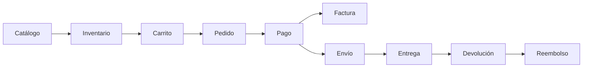
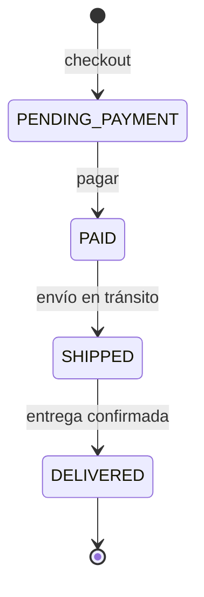
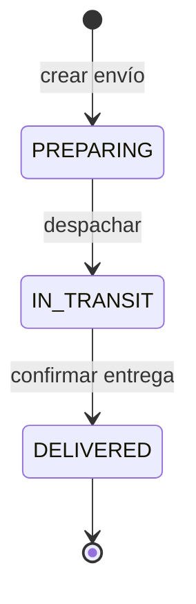
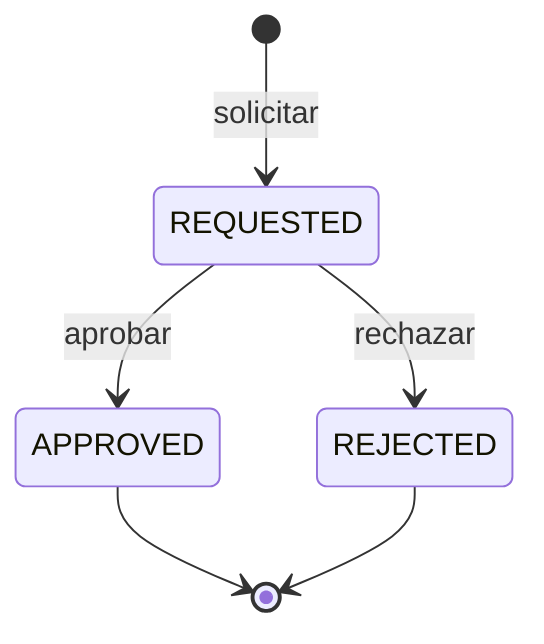
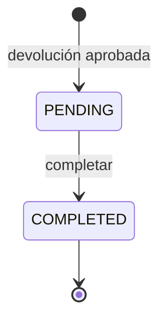

# Arquitectura y decisiones técnicas

> La especificación funcional **no** define tecnología, arquitectura ni almacenamiento (ver sección 3.2 del documento fuente). Todo lo que aparece en este archivo son decisiones tomadas durante la implementación.

## 1. Visión general

NexusMarket Backend es una API REST construida con **Node.js, TypeScript y Express 5**, organizada por capas. Los datos se están migrando, módulo por módulo, de memoria a dos bases de datos: **PostgreSQL** para lo transaccional y **MongoDB** para lo flexible (ver sección 6.1). Solo cambia la capa de repositorios; la lógica de negocio no se toca.

## 2. Arquitectura por capas

Cada petición atraviesa las mismas capas, en este orden:

```
Cliente
  │
  ▼
app.ts ─────────── express.json() · rutas públicas (/api/auth) · authenticate (todo lo demás)
  │
  ▼
routes ─────────── asocia URL + método con un controller y declara los permisos por rol
  │                (authorize · ownerOrRoles)
  ▼
controllers ────── traduce HTTP → llamada al servicio; valida parámetros; controla la
  │                propiedad del recurso
  ▼
services ───────── lógica de negocio y reglas; coordina otros servicios;
  │                lanza errores tipados (ValidationError, NotFoundError…)
  ▼
repositories ───── acceso a datos asíncrono (PostgreSQL vía Prisma; memoria mientras se migra)

errorHandler ───── middleware final: convierte cualquier error en la respuesta HTTP
```

Todas las capas, desde el repositorio hasta el controller, son **asíncronas** (`async`/`await`). Los repositorios en memoria devuelven **copias** de lo guardado, igual que lo haría una base de datos: para persistir un cambio hay que llamar a `update()`. Así, cambiar los arrays por PostgreSQL o MongoDB solo toca la capa `repositories`.

### Manejo de errores

Los servicios no conocen HTTP: expresan **qué pasó** lanzando una clase de `src/errors/AppError.ts`, y el middleware `errorHandler` decide la respuesta. Express 5 envía automáticamente a ese middleware cualquier error lanzado dentro de un controller `async`, por eso los controllers no usan `try/catch`.

| Clase | Código | Cuándo |
|---|---|---|
| `ValidationError` | `400` | Datos inválidos o regla de negocio incumplida (transición inválida, stock insuficiente…) |
| `UnauthorizedError` | `401` | Falta el token, el token no es válido o las credenciales son incorrectas |
| `ForbiddenError` | `403` | Rol sin permiso, recurso ajeno o cuenta bloqueada |
| `NotFoundError` | `404` | El recurso pedido (o uno del que depende) no existe |
| `ConflictError` | `409` | El recurso ya existe (correo, perfil, factura, envío o reembolso duplicados) |
| Cualquier otro | `500` | Fallo inesperado: se registra en consola y el cliente recibe un mensaje genérico |

El JSON mal formado responde `400` y las rutas inexistentes `404`.

| Capa | Carpeta | Responsabilidad | Lo que NO debe hacer |
|---|---|---|---|
| Modelos | `src/models` | Describir la forma de los datos (interfaces y enums). | Contener lógica. |
| Repositorios | `src/repositories` | Leer y escribir datos (asíncrono). | Conocer reglas de negocio ni llamar a servicios. |
| Servicios | `src/services` | Aplicar reglas de negocio y lanzar errores tipados. | Conocer HTTP (`req`, `res`, códigos de estado) ni acceder a repositorios de otros módulos. |
| Errores | `src/errors` | Definir las clases de error y su código HTTP. | Contener lógica. |
| Controllers | `src/controllers` | Adaptar HTTP al servicio y verificar propiedad del recurso. | Contener reglas de negocio. |
| Rutas | `src/routes` | Declarar endpoints y permisos por rol. | Contener lógica. |
| Middlewares | `src/middlewares` | Autenticación, autorización y manejo de errores transversales. | Contener reglas de negocio. |
| Utilidades | `src/utils` | Funciones puras de apoyo (hash de contraseñas, JWT). | Depender de otras capas. |

## 3. Mapa de dependencias entre servicios

Un servicio solo habla con **otros servicios**, nunca con repositorios ajenos. Estas son las dependencias reales:

| Servicio | Depende de |
|---|---|
| `UserService` | — |
| `AuthService` | `UserService` |
| `BuyerService` | `UserService` |
| `SellerService` | `UserService` |
| `ProductService` | `SellerService` |
| `WarehouseService` | `SellerService` |
| `InventoryService` | `ProductService`, `WarehouseService` |
| `CartService` | `BuyerService`, `ProductService` |
| `OrderService` | `CartService`, `ProductService`, `WarehouseService`, `InventoryService` |
| `InvoiceService` | `OrderService` |
| `ShipmentService` | `OrderService` |
| `ReturnService` | `OrderService`, `InventoryService`, `RefundService` |
| `RefundService` | — |
| `ReportService` | Todos (solo lectura) |

`RefundService` no depende de `ReturnService` a propósito: haberlo hecho habría creado una **dependencia circular** (cada uno importando al otro). Por eso `ReturnService` calcula el monto y se lo entrega ya resuelto a `RefundService.generateRefund`.

## 4. Flujo principal del negocio



## 5. Máquinas de estado

Los ciclos de vida están declarados en una **tabla de transiciones** dentro de cada servicio (`allowedTransitions`), no en `if` dispersos. Agregar o cambiar un estado es editar esa tabla.

### Pedido (`OrderStatus`)



`DELIVERED` es un estado final: un pedido entregado es **inmutable**.

### Envío (`ShipmentStatus`)



El envío **conduce** al pedido: al pasar a `IN_TRANSIT` el pedido pasa a `SHIPPED`, y al pasar a `DELIVERED` el pedido pasa a `DELIVERED`.

### Devolución (`ReturnStatus`)



### Reembolso (`RefundStatus`)



### Producto (`ProductStatus`)

`PUBLISHED`, `SUSPENDED` y `DISCONTINUED`. Solo los productos `PUBLISHED` se pueden agregar al carrito y comprar.

## 6. Modelo de datos (resumen)

| Entidad | Se identifica por | Relaciones |
|---|---|---|
| `User` | `id` (UUID) | — |
| `Credential` | `userId` | 1 a 1 con `User` (guarda el hash de la contraseña, separado a propósito) |
| `Buyer` | `userId` | 1 a 1 con `User` |
| `Seller` | `userId` | 1 a 1 con `User`; `warehouseIds` se calcula desde las bodegas que apuntan a él |
| `Warehouse` | `id` | opcionalmente pertenece a un `Seller` |
| `Product` | `id` | pertenece a un `Seller`; tiene `Variant[]` |
| `InventoryItem` | `productId` + `warehouseId` | existencias de un producto en una bodega |
| `InventoryMovement` | `id` | bitácora de cada operación sobre el inventario |
| `Cart` | `buyerId` | 1 a 1 con `Buyer`; tiene `CartItem[]` |
| `Order` | `id` | pertenece a un `Buyer`; tiene `OrderItem[]` |
| `Invoice` | `id` | 1 a 1 con `Order` |
| `Shipment` | `id` | 1 a 1 con `Order`; tiene `ShipmentEvent[]` |
| `ReturnRequest` | `id` | pertenece a un `Order` y a un producto |
| `Refund` | `id` | 1 a 1 con `ReturnRequest` |

### 6.1 Persistencia: qué va en cada base de datos

| Base de datos | Entidades | Por qué | Estado |
|---|---|---|---|
| **PostgreSQL** (Prisma) | `User`, `Credential` | Integridad y unicidad del correo. | ✅ Migrado |
| **PostgreSQL** (Prisma) | `Buyer` (+ `buyer_addresses`), `Seller`, `Warehouse` | Relaciones fuertes con `users`; las bodegas de un vendedor se calculan con la llave foránea `warehouses.seller_id`. | ✅ Migrado |
| **PostgreSQL** (Prisma) | `InventoryItem`, `Order` (+ `order_items`) | El checkout necesita **transacciones** y actualizaciones atómicas del inventario. | ✅ Migrado |
| **PostgreSQL** (Prisma) | `Invoice`, `Shipment`, `ReturnRequest`, `Refund` | Dinero, máquinas de estado y relaciones fuertes con `orders`; la aprobación de devoluciones necesita transacción. Los reportes se resolverán con `GROUP BY`. | Esquema creado; repositorios pendientes |
| **MongoDB** (Mongoose) | `Product` | Catálogo flexible: variantes y atributos distintos según el tipo de producto. | Pendiente |
| **MongoDB** (Mongoose) | `Cart` | Un documento por comprador, de escritura frecuente y vida corta (puede expirar con índice TTL). | Pendiente |
| **MongoDB** (Mongoose) | `InventoryMovement` | Bitácora que solo crece. Ya separada en su propio repositorio y escrita con `afterCommit`. | Pendiente |

Las tablas SQL que referencian productos (`inventory_items`, `order_items`, `return_requests`) guardan `product_id` como texto **sin llave foránea**, porque el producto vive en otra base de datos. Por eso la integridad de esa referencia la valida el servicio (`ProductService.getProductById`).

Esquema: [`prisma/schema.prisma`](../prisma/schema.prisma). Migraciones: `prisma/migrations/`.

#### Transacciones

`src/db/transaction.ts` ofrece una **unidad de trabajo**: un servicio envuelve varias operaciones en `transaction(async () => { ... })`, y todos los repositorios SQL que se ejecuten dentro usan la misma transacción. El cliente activo se encuentra solo (`db()`, mediante `AsyncLocalStorage`), así que no hay que pasarlo de función en función ni cambiar las firmas de los repositorios. Si algo lanza un error, se deshace todo. Una transacción anidada reutiliza la exterior.

Lo que vive fuera de PostgreSQL (la bitácora de movimientos, el carrito) no se puede deshacer. Para eso existe `afterCommit(fn)`: la acción se ejecuta **solo si la transacción se confirma** (o de inmediato si no hay transacción). Así un checkout fallido no deja movimientos de inventario que nunca ocurrieron.

Usos actuales: `AuthService.registerUser` (usuario + credencial), `OrderService.checkout` (reservas + pedido) y `OrderService.changeStatus` (estado + salida de inventario al despachar).

#### Concurrencia en inventario y pedidos

| Técnica | Dónde | Qué evita |
|---|---|---|
| **UPDATE condicional atómico** (`UPDATE ... SET reservado = reservado + n WHERE disponible >= n`) | reservar, despachar, marcar dañado | Que dos peticiones simultáneas usen la misma unidad (sobreventa). La condición y el cambio son una sola sentencia. |
| **`INSERT ... ON CONFLICT DO UPDATE`** (upsert de Prisma) | ingreso de mercancía | Que dos ingresos simultáneos creen dos filas o pierdan una suma. |
| **Orden fijo de bloqueo** (producto + bodega) | checkout y despacho | Interbloqueos: dos pedidos que bloquean las mismas filas en orden opuesto. |
| **Transición de estado condicional** (`UPDATE orders SET status = nuevo WHERE id = ? AND status = actual`) | cambio de estado de pedido | Que dos despachos simultáneos saquen el inventario dos veces; el perdedor recibe `409`. |

Probado con peticiones simultáneas reales: 5 checkouts de 3 unidades sobre un stock de 10 (3 pedidos, 9 reservadas); 6 checkouts cruzados de dos productos con stock para uno solo (1 pedido, sin deadlocks, sin reservas parciales); y dos despachos simultáneos del mismo pedido (un `200`, un `409`, el stock sale una vez).

## 7. Registro de decisiones

| # | Decisión | Motivo | Alternativa descartada |
|---|---|---|---|
| D-01 | **TypeScript** en el backend. | Muchas reglas de negocio y catálogos cerrados (estados, roles): el tipado estático y los `enum` evitan estados inválidos y dan contratos claros entre capas. | JavaScript puro. |
| D-02 | **Express 5** como framework. | Estándar muy extendido, simple y con mucha documentación. | NestJS, Fastify. |
| D-03 | **CommonJS** (`"module": "commonjs"`). | Menos fricción: imports normales, sin extensiones `.js` obligatorias ni configuración especial de herramientas. | ESM con `nodenext`. |
| D-04 | **TypeScript 5.x**, no 7. | `ts-node-dev` aún no es compatible con TypeScript 7 (falla al leer la configuración). | TypeScript 7. |
| D-05 | Configuración estricta: `strict`, `noUncheckedIndexedAccess`, `exactOptionalPropertyTypes`. | Obliga a manejar `undefined` y propiedades opcionales de forma explícita. | Configuración permisiva. |
| D-06 | **Arquitectura por capas** (modelo → repositorio → servicio → controller → ruta). | Separa responsabilidades y permite cambiar el almacenamiento sin tocar la lógica. | Todo en los controllers. |
| D-07 | **Repositorios en memoria** (temporal; se reemplazan desde D-29). | La especificación no define almacenamiento; permite avanzar en la lógica sin decidir la base de datos aún. | Conectar una base de datos desde el inicio. |
| D-08 | Un servicio solo llama a **otros servicios**, no a repositorios ajenos. | Mantiene las reglas de cada módulo en un único lugar. | Acceso directo entre capas. |
| D-09 | **Referencias por id**, sin duplicar datos (`Buyer` y `Seller` apuntan a `User` con `userId`). | Evita inconsistencias: el correo vive en un solo lugar. | Copiar los campos de `User` en `Buyer`/`Seller`. |
| D-10 | **Instantáneas de precio**: `OrderItem.unitPrice` e `Invoice.amount` se copian al crearse. | Los pedidos y facturas ya emitidos no deben cambiar si el precio del producto cambia después. | Leer siempre el precio actual. |
| D-11 | **Checkout en dos fases**: validar todo y solo después reservar stock. | Evita dejar stock reservado por un pedido que nunca se creó. | Reservar item por item. |
| D-12 | **Credenciales separadas de `User`**, con hash `scrypt` + sal. | Evita filtrar el hash en cualquier respuesta que devuelva un usuario; `scrypt` viene en Node, sin dependencias extra. | Campo `passwordHash` dentro de `User`. |
| D-13 | **JWT** firmado con `JWT_SECRET` y expiración configurable. | Autenticación sin estado de sesión en el servidor. | Sesiones en servidor. |
| D-14 | El **rol se lee del estado actual** del usuario en cada petición, no del token. | Un cambio de rol o un bloqueo surte efecto de inmediato. | Confiar en el rol que trae el token. |
| D-15 | **Registro público solo crea `BUYER`**; el primer `ADMIN` se siembra desde `.env`. | Nadie puede auto-asignarse un rol; resuelve quién crea al primer administrador. | Aceptar el rol enviado en el registro. |
| D-16 | **Mensaje genérico en el login** ("Credenciales inválidas."). | No revela qué correos están registrados. | Mensajes distintos según el fallo. |
| D-17 | **Autorización en dos niveles**: por rol (middleware en la ruta) y por propiedad (en el controller). | Un rol correcto no basta: un vendedor no debe tocar productos de otro. | Solo control por rol. |
| D-18 | **La identidad sale del token, nunca del body.** | El cliente no puede suplantar a otra persona enviando un `buyerId` o `sellerId` ajeno. | Leer `buyerId` del body. |
| D-19 | Pasar el usuario autenticado por **`res.locals`**. | Evita ampliar los tipos de Express con declaraciones globales, que fallan con `ts-node-dev`. | `req.user` con declaración global. |
| D-20 | El **envío conduce el estado del pedido**; el pedido se actualiza primero. | Si falla el pedido (por ejemplo, por inventario), el envío no cambia y no quedan desincronizados. | Que cada módulo cambie su estado por separado. |
| D-21 | **Pago simulado** (`POST /orders/:id/pay`). | La especificación no define pasarela de pagos. | Integrar una pasarela real. |
| D-22 | **Reportes de solo lectura** consolidados desde los servicios, sin repositorio propio. | Un reporte es una vista de datos de otros módulos (OBJ-12), no una entidad. | Duplicar datos en una tabla de reportes. |
| D-23 | `reserve`, `outbound` y `return` de inventario **solo para ADMIN**. | Son operaciones internas del sistema; abiertas, un vendedor podría reservar el stock de otro. | Exponerlas a vendedores. |
| D-24 | **Todas las capas asíncronas**, todavía con almacenamiento en memoria. | Cualquier base de datos responde con promesas; migrar primero la firma permite conectar PostgreSQL y MongoDB cambiando solo los repositorios. | Conectar la base de datos y pasar a `async` al mismo tiempo. |
| D-25 | **Repositorios en memoria que devuelven copias** (`structuredClone`). | Simulan una base de datos real: si un servicio modifica un objeto sin llamar a `update()`, el cambio se pierde ya hoy y no al migrar. Así se encontró que `linkToSeller` no guardaba el `sellerId` de la bodega. | Devolver referencias a los objetos guardados. |
| D-26 | **Errores tipados + middleware central** en lugar de `try/catch` con códigos fijos en cada controller. | Antes, un mismo error podía responder `400` o `404` según el controller. Ahora el código lo decide el tipo de error, en un solo lugar, y los fallos inesperados responden `500` sin filtrar detalles. | Mantener `try/catch` por controller. |
| D-27 | **`404` para recursos inexistentes y `409` para duplicados** en todos los endpoints. | Códigos coherentes en toda la API. Antes varios endpoints respondían `400` en ambos casos. | Responder siempre `400`. |
| D-28 | **Login de cuenta bloqueada responde `403`** (antes `401`). | Las credenciales son correctas: el problema es de permiso, igual que en `authenticate`. | Mantener `401`. |
| D-29 | **Persistencia políglota**: PostgreSQL para lo transaccional, MongoDB para catálogo, carritos y bitácora (sección 6.1). | Cada dato en el motor que mejor encaja con su forma y su forma de uso. | Una sola base de datos para todo. |
| D-30 | **Prisma 7.10.1** como ORM de PostgreSQL, con versión exacta. | Tipos generados a partir del esquema y migraciones versionadas. El tag `latest` de npm apuntaba a una *release candidate* de Prisma 8; se fija la última estable (lección de D-04). | TypeORM, Drizzle, SQL a mano. |
| D-31 | **Docker Compose** para las bases de datos de desarrollo. | Mismo entorno en cualquier equipo con un comando (`npm run db:up`). MongoDB se publica en el puerto 27018 para no chocar con instalaciones locales. | Instalar PostgreSQL y MongoDB en el equipo. |
| D-32 | **Unidad de trabajo con `AsyncLocalStorage`** (`transaction()` / `db()`). | Los servicios agrupan operaciones atómicas sin conocer Prisma ni cambiar la firma de los repositorios. | Pasar el cliente de transacción como parámetro a cada repositorio. |
| D-33 | **Migración incremental**, módulo por módulo, empezando por usuarios y credenciales. | Cada paso se prueba de punta a punta antes de seguir; los módulos en memoria y en PostgreSQL conviven. | Migrar todo de una vez. |
| D-34 | **Dinero como `DECIMAL(12,2)`** en PostgreSQL. | Evita los errores de redondeo del punto flotante. Los repositorios lo convierten a `number` para no cambiar los modelos de dominio. | Enteros en centavos (habría cambiado toda la API). |
| D-35 | **La restricción `UNIQUE` de la base de datos es la última defensa** contra duplicados; su violación (Prisma `P2002`) se responde como `409`. | El chequeo previo del servicio no basta si dos peticiones llegan a la vez. | Confiar solo en el chequeo del servicio. |
| D-36 | **`Seller.warehouseIds` se calcula** desde `warehouses.seller_id` en lugar de guardarse como lista. | Una sola fuente de verdad: elimina la limitación de que crear una bodega con `sellerId` no actualizaba al vendedor, y reasignar una bodega ya no la deja duplicada en dos vendedores. `PATCH /sellers/:userId/warehouses` pasa a usar `WarehouseService.linkToSeller`, que valida la bodega. | Columna con lista de ids en `sellers`. |
| D-37 | **Direcciones del comprador en su propia tabla** (`buyer_addresses`) con `is_primary` y `position`. | Modelo relacional normal; `position` conserva el orden de las direcciones adicionales. Se guardan solo los cuatro campos del modelo, nunca lo que el cliente agregue de más. | Columna JSON en `buyers`. |
| D-38 | **Validación de entrada antes de la base de datos** (direcciones, tipo de bodega, estado comercial) e **ids mal formados = `404`**. | Con PostgreSQL, un campo faltante o un id que no es UUID provocaban un error `500`; ahora son `400` y `404`, que es lo que corresponde. | Dejar que la base de datos rechace el dato. |
| D-39 | **Reservas y despachos con `UPDATE` condicionales atómicos** en lugar de `SELECT ... FOR UPDATE`. | Una sola sentencia comprueba y modifica: no hay ventana entre leer y escribir, y no hace falta SQL de bloqueo explícito. | Leer, comprobar en Node y escribir (permitía sobreventa); `SELECT ... FOR UPDATE`. |
| D-40 | **Orden fijo (producto + bodega) al tocar varias filas de inventario.** | Evita interbloqueos entre checkouts con los mismos productos en distinto orden. | Reservar en el orden del carrito. |
| D-41 | **Transiciones de estado de pedido condicionales** (`WHERE status = actual`), con `409` para el perdedor. | Control de concurrencia optimista: impide aplicar dos veces los efectos de una transición (doble despacho). | Bloqueo pesimista de la fila del pedido. |
| D-42 | **`afterCommit` para lo que vive fuera de PostgreSQL** (bitácora de movimientos, vaciado del carrito). | Un rollback no puede deshacer escrituras en memoria o en MongoDB; diferirlas evita registros fantasma. | Escribirlas dentro de la transacción. |
| D-43 | **Cantidades enteras positivas** validadas en carrito e inventario. | Las columnas son `INT`; una cantidad como `1.5` terminaba en `500` al llegar a la base de datos. | Redondear en silencio. |

## 8. Limitaciones conocidas

Se documentan de forma honesta para que no se confundan con funcionalidades:

- **Migración a base de datos incompleta**: usuarios, credenciales, perfiles, bodegas, inventario y pedidos están en PostgreSQL; productos, carritos, bitácora, facturas, envíos, devoluciones y reembolsos siguen en memoria y se pierden al reiniciar. Mientras tanto, tras un reinicio quedan pedidos e inventario que apuntan a productos que ya no existen (los reportes los muestran como "Producto desconocido"). Se resuelve al llevar el catálogo a MongoDB.
- **El pago es simulado**: solo cambia el estado del pedido.
- **Los productos digitales también pasan por inventario**, aunque conceptualmente no tienen stock físico.
- **Toda unidad devuelta vuelve al stock disponible**; no se distingue si regresó defectuosa.
- **Aprobar una devolución no es atómico**: con una base de datos real debería ir en una transacción.
- **`PATCH /orders/:id/status` (solo ADMIN) puede desincronizar** un pedido respecto de su envío; es una herramienta administrativa.
- **Validación de entrada limitada**: no se verifica que los valores de enums enviados en el body (`status`, `type`, `commercialStatus`…) pertenezcan al enum, ni se usa una librería de validación.
- **Los correos no se normalizan** (mayúsculas y minúsculas cuentan como distintos).
- **Sin límite de intentos de login**, sin paginación y sin pruebas automatizadas.
- **El dinero se maneja como `number`** (punto flotante); en producción conviene usar enteros en centavos.
