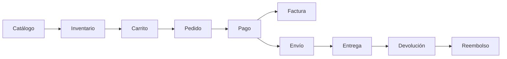
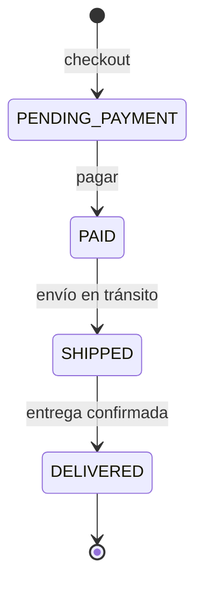
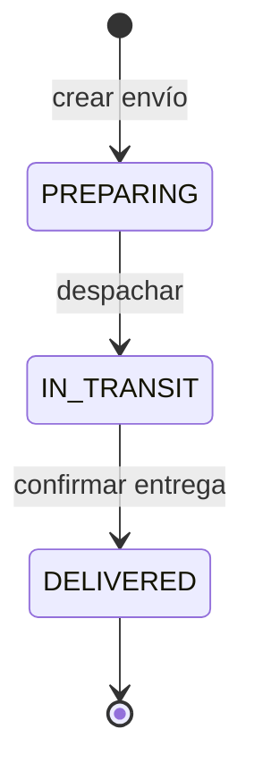
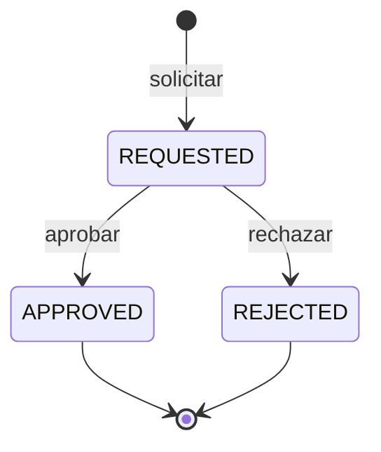
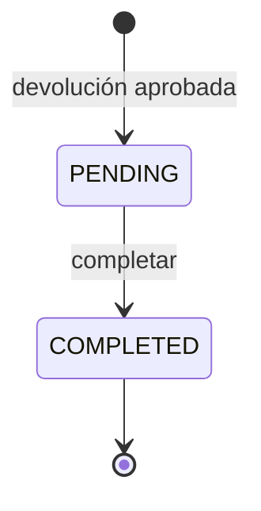

# Arquitectura y decisiones técnicas

> La especificación funcional **no** define tecnología, arquitectura ni almacenamiento (ver sección 3.2 del documento fuente). Todo lo que aparece en este archivo son decisiones tomadas durante la implementación.

## 1. Visión general

NexusMarket Backend es una API REST construida con **Node.js, TypeScript y Express 5**, organizada por capas. Hoy los datos viven **en memoria** (se pierden al reiniciar); la arquitectura está pensada para reemplazar esa capa por una base de datos real sin tocar la lógica de negocio.

## 2. Arquitectura por capas

Cada petición atraviesa las mismas capas, en este orden:

```
Cliente
  │
  ▼
app.ts ─────────── express.json() · rutas públicas (/api/auth) · authenticate (todo lo demás)
  │
  ▼
routes ─────────── asocia URL + método con un controller y declara los permisos por rol
  │                (authorize · ownerOrRoles)
  ▼
controllers ────── traduce HTTP → llamada al servicio; valida parámetros; controla la
  │                propiedad del recurso; traduce errores a códigos HTTP
  ▼
services ───────── lógica de negocio y reglas; coordina otros servicios
  │
  ▼
repositories ───── acceso a datos (hoy arrays en memoria)
```

| Capa | Carpeta | Responsabilidad | Lo que NO debe hacer |
|---|---|---|---|
| Modelos | `src/models` | Describir la forma de los datos (interfaces y enums). | Contener lógica. |
| Repositorios | `src/repositories` | Leer y escribir datos. | Conocer reglas de negocio ni llamar a servicios. |
| Servicios | `src/services` | Aplicar reglas de negocio. | Conocer HTTP (`req`, `res`) ni acceder a repositorios de otros módulos. |
| Controllers | `src/controllers` | Adaptar HTTP al servicio y verificar propiedad del recurso. | Contener reglas de negocio. |
| Rutas | `src/routes` | Declarar endpoints y permisos por rol. | Contener lógica. |
| Middlewares | `src/middlewares` | Autenticación y autorización transversales. | Contener reglas de negocio. |
| Utilidades | `src/utils` | Funciones puras de apoyo (hash de contraseñas, JWT). | Depender de otras capas. |

## 3. Mapa de dependencias entre servicios

Un servicio solo habla con **otros servicios**, nunca con repositorios ajenos. Estas son las dependencias reales:

| Servicio | Depende de |
|---|---|
| `UserService` | — |
| `AuthService` | `UserService` |
| `BuyerService` | `UserService` |
| `SellerService` | `UserService` |
| `ProductService` | `SellerService` |
| `WarehouseService` | `SellerService` |
| `InventoryService` | `ProductService`, `WarehouseService` |
| `CartService` | `BuyerService`, `ProductService` |
| `OrderService` | `CartService`, `ProductService`, `WarehouseService`, `InventoryService` |
| `InvoiceService` | `OrderService` |
| `ShipmentService` | `OrderService` |
| `ReturnService` | `OrderService`, `InventoryService`, `RefundService` |
| `RefundService` | — |
| `ReportService` | Todos (solo lectura) |

`RefundService` no depende de `ReturnService` a propósito: haberlo hecho habría creado una **dependencia circular** (cada uno importando al otro). Por eso `ReturnService` calcula el monto y se lo entrega ya resuelto a `RefundService.generateRefund`.

## 4. Flujo principal del negocio



## 5. Máquinas de estado

Los ciclos de vida están declarados en una **tabla de transiciones** dentro de cada servicio (`allowedTransitions`), no en `if` dispersos. Agregar o cambiar un estado es editar esa tabla.

### Pedido (`OrderStatus`)



`DELIVERED` es un estado final: un pedido entregado es **inmutable**.

### Envío (`ShipmentStatus`)



El envío **conduce** al pedido: al pasar a `IN_TRANSIT` el pedido pasa a `SHIPPED`, y al pasar a `DELIVERED` el pedido pasa a `DELIVERED`.

### Devolución (`ReturnStatus`)



### Reembolso (`RefundStatus`)



### Producto (`ProductStatus`)

`PUBLISHED`, `SUSPENDED` y `DISCONTINUED`. Solo los productos `PUBLISHED` se pueden agregar al carrito y comprar.

## 6. Modelo de datos (resumen)

| Entidad | Se identifica por | Relaciones |
|---|---|---|
| `User` | `id` (UUID) | — |
| `Credential` | `userId` | 1 a 1 con `User` (guarda el hash de la contraseña, separado a propósito) |
| `Buyer` | `userId` | 1 a 1 con `User` |
| `Seller` | `userId` | 1 a 1 con `User`; tiene `warehouseIds` |
| `Warehouse` | `id` | opcionalmente pertenece a un `Seller` |
| `Product` | `id` | pertenece a un `Seller`; tiene `Variant[]` |
| `InventoryItem` | `productId` + `warehouseId` | existencias de un producto en una bodega |
| `InventoryMovement` | `id` | bitácora de cada operación sobre el inventario |
| `Cart` | `buyerId` | 1 a 1 con `Buyer`; tiene `CartItem[]` |
| `Order` | `id` | pertenece a un `Buyer`; tiene `OrderItem[]` |
| `Invoice` | `id` | 1 a 1 con `Order` |
| `Shipment` | `id` | 1 a 1 con `Order`; tiene `ShipmentEvent[]` |
| `ReturnRequest` | `id` | pertenece a un `Order` y a un producto |
| `Refund` | `id` | 1 a 1 con `ReturnRequest` |

## 7. Registro de decisiones

| # | Decisión | Motivo | Alternativa descartada |
|---|---|---|---|
| D-01 | **TypeScript** en el backend. | Muchas reglas de negocio y catálogos cerrados (estados, roles): el tipado estático y los `enum` evitan estados inválidos y dan contratos claros entre capas. | JavaScript puro. |
| D-02 | **Express 5** como framework. | Estándar muy extendido, simple y con mucha documentación. | NestJS, Fastify. |
| D-03 | **CommonJS** (`"module": "commonjs"`). | Menos fricción: imports normales, sin extensiones `.js` obligatorias ni configuración especial de herramientas. | ESM con `nodenext`. |
| D-04 | **TypeScript 5.x**, no 7. | `ts-node-dev` aún no es compatible con TypeScript 7 (falla al leer la configuración). | TypeScript 7. |
| D-05 | Configuración estricta: `strict`, `noUncheckedIndexedAccess`, `exactOptionalPropertyTypes`. | Obliga a manejar `undefined` y propiedades opcionales de forma explícita. | Configuración permisiva. |
| D-06 | **Arquitectura por capas** (modelo → repositorio → servicio → controller → ruta). | Separa responsabilidades y permite cambiar el almacenamiento sin tocar la lógica. | Todo en los controllers. |
| D-07 | **Repositorios en memoria** (temporal). | La especificación no define almacenamiento; permite avanzar en la lógica sin decidir la base de datos aún. | Conectar una base de datos desde el inicio. |
| D-08 | Un servicio solo llama a **otros servicios**, no a repositorios ajenos. | Mantiene las reglas de cada módulo en un único lugar. | Acceso directo entre capas. |
| D-09 | **Referencias por id**, sin duplicar datos (`Buyer` y `Seller` apuntan a `User` con `userId`). | Evita inconsistencias: el correo vive en un solo lugar. | Copiar los campos de `User` en `Buyer`/`Seller`. |
| D-10 | **Instantáneas de precio**: `OrderItem.unitPrice` e `Invoice.amount` se copian al crearse. | Los pedidos y facturas ya emitidos no deben cambiar si el precio del producto cambia después. | Leer siempre el precio actual. |
| D-11 | **Checkout en dos fases**: validar todo y solo después reservar stock. | Evita dejar stock reservado por un pedido que nunca se creó. | Reservar item por item. |
| D-12 | **Credenciales separadas de `User`**, con hash `scrypt` + sal. | Evita filtrar el hash en cualquier respuesta que devuelva un usuario; `scrypt` viene en Node, sin dependencias extra. | Campo `passwordHash` dentro de `User`. |
| D-13 | **JWT** firmado con `JWT_SECRET` y expiración configurable. | Autenticación sin estado de sesión en el servidor. | Sesiones en servidor. |
| D-14 | El **rol se lee del estado actual** del usuario en cada petición, no del token. | Un cambio de rol o un bloqueo surte efecto de inmediato. | Confiar en el rol que trae el token. |
| D-15 | **Registro público solo crea `BUYER`**; el primer `ADMIN` se siembra desde `.env`. | Nadie puede auto-asignarse un rol; resuelve quién crea al primer administrador. | Aceptar el rol enviado en el registro. |
| D-16 | **Mensaje genérico en el login** ("Credenciales inválidas."). | No revela qué correos están registrados. | Mensajes distintos según el fallo. |
| D-17 | **Autorización en dos niveles**: por rol (middleware en la ruta) y por propiedad (en el controller). | Un rol correcto no basta: un vendedor no debe tocar productos de otro. | Solo control por rol. |
| D-18 | **La identidad sale del token, nunca del body.** | El cliente no puede suplantar a otra persona enviando un `buyerId` o `sellerId` ajeno. | Leer `buyerId` del body. |
| D-19 | Pasar el usuario autenticado por **`res.locals`**. | Evita ampliar los tipos de Express con declaraciones globales, que fallan con `ts-node-dev`. | `req.user` con declaración global. |
| D-20 | El **envío conduce el estado del pedido**; el pedido se actualiza primero. | Si falla el pedido (por ejemplo, por inventario), el envío no cambia y no quedan desincronizados. | Que cada módulo cambie su estado por separado. |
| D-21 | **Pago simulado** (`POST /orders/:id/pay`). | La especificación no define pasarela de pagos. | Integrar una pasarela real. |
| D-22 | **Reportes de solo lectura** consolidados desde los servicios, sin repositorio propio. | Un reporte es una vista de datos de otros módulos (OBJ-12), no una entidad. | Duplicar datos en una tabla de reportes. |
| D-23 | `reserve`, `outbound` y `return` de inventario **solo para ADMIN**. | Son operaciones internas del sistema; abiertas, un vendedor podría reservar el stock de otro. | Exponerlas a vendedores. |

## 8. Limitaciones conocidas

Se documentan de forma honesta para que no se confundan con funcionalidades:

- **Los datos viven en memoria**: se pierden al reiniciar el servidor.
- **El pago es simulado**: solo cambia el estado del pedido.
- **Los productos digitales también pasan por inventario**, aunque conceptualmente no tienen stock físico.
- **Toda unidad devuelta vuelve al stock disponible**; no se distingue si regresó defectuosa.
- **Aprobar una devolución no es atómico**: con una base de datos real debería ir en una transacción.
- **`PATCH /orders/:id/status` (solo ADMIN) puede desincronizar** un pedido respecto de su envío; es una herramienta administrativa.
- **`Seller.warehouseIds` solo se actualiza** al vincular una bodega (`link-seller`) o asignarla por el perfil; crear una bodega con `sellerId` no lo actualiza.
- **Validación de entrada limitada**: no se verifica que los valores de enums enviados en el body (`status`, `type`, `commercialStatus`…) pertenezcan al enum, ni se usa una librería de validación.
- **Los correos no se normalizan** (mayúsculas y minúsculas cuentan como distintos).
- **Sin límite de intentos de login**, sin paginación y sin pruebas automatizadas.
- **El dinero se maneja como `number`** (punto flotante); en producción conviene usar enteros en centavos.
