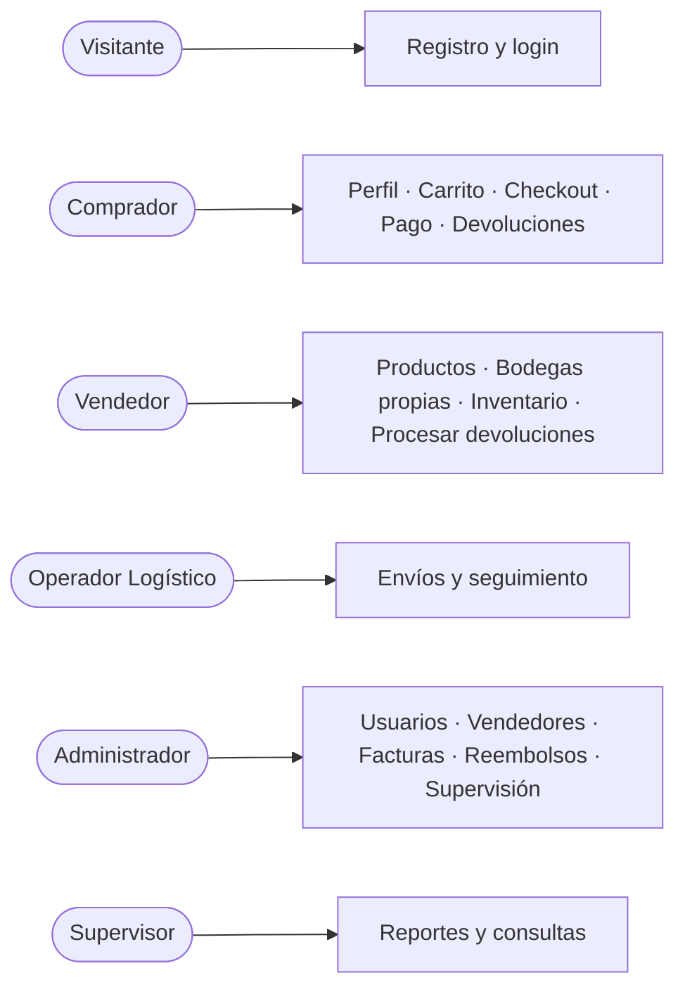

# Casos de uso

Cada caso de uso describe una interacción concreta entre un **actor** y el sistema. Cada uno corresponde a uno o varios endpoints implementados. Todos los endpoints bajo `/api` (excepto `/api/auth/register` y `/api/auth/login`) exigen el header `Authorization: Bearer <token>` (**RG-01**); sin token la respuesta es `401`, y con un rol o propietario incorrecto es `403`.

## Actores

| Actor | Rol en el sistema | Descripción (según la especificación) |
|---|---|---|
| Visitante | — | Persona sin sesión. Solo puede registrarse o iniciar sesión. |
| Comprador | `BUYER` | Participa en procesos de compra. |
| Vendedor | `SELLER` | Publica y gestiona sus productos y bodegas. |
| Operador Logístico | `LOGISTICS_OPERATOR` | Encargado de la operación física de bodegas y despachos. |
| Administrador | `ADMIN` | Responsable de la administración de vendedores y bodegas. |
| Supervisor | `SUPERVISOR` | Perfil de consulta y seguimiento operativo. |

## Índice

| Módulo | Casos de uso |
|---|---|
| Autenticación y usuarios | CU-01 a CU-06 |
| Compradores | CU-07 a CU-09 |
| Vendedores | CU-10 a CU-11 |
| Bodegas | CU-12 a CU-13 |
| Catálogo de productos | CU-14 a CU-17 |
| Inventario | CU-18 a CU-21 |
| Carrito | CU-22 a CU-24 |
| Pedidos | CU-25 a CU-28 |
| Facturación | CU-29 a CU-30 |
| Logística | CU-31 a CU-33 |
| Devoluciones | CU-34 a CU-36 |
| Reembolsos | CU-37 a CU-38 |
| Reportes | CU-39 |

---

## Autenticación y usuarios

### CU-01 Registrarse como comprador
- **Actor:** Visitante
- **Precondiciones:** ninguna.
- **Flujo principal:**
  1. El visitante envía nombre completo, correo y contraseña.
  2. El sistema valida que la contraseña tenga al menos 8 caracteres.
  3. El sistema valida que el correo no esté registrado.
  4. El sistema crea el usuario con rol `BUYER` y estado `ACTIVE`, y guarda su credencial (solo el hash).
  5. El sistema responde `201` con el usuario, sin la contraseña.
- **Flujos alternativos:**
  - 2a. Contraseña corta → `400`.
  - 3a. Correo ya registrado → `400`.
  - Cualquier `role` enviado en el cuerpo se **ignora**: el registro público solo crea compradores.
- **Postcondiciones:** existe un usuario `BUYER` activo (aún sin perfil de comprador, ver CU-07).
- **Endpoint:** `POST /api/auth/register`

### CU-02 Iniciar sesión
- **Actor:** cualquier usuario registrado
- **Precondiciones:** el usuario tiene una cuenta activa.
- **Flujo principal:**
  1. El usuario envía correo y contraseña.
  2. El sistema busca al usuario y verifica la contraseña contra su hash.
  3. El sistema verifica que la cuenta esté `ACTIVE`.
  4. El sistema genera un JWT (con el id del usuario y su rol) y responde `200` con el token y el usuario.
- **Flujos alternativos:**
  - 2a. Correo inexistente o contraseña incorrecta → `401` con el mismo mensaje en ambos casos ("Credenciales inválidas."), para no revelar qué correos existen.
  - 3a. Cuenta bloqueada → `401` con mensaje de bloqueo.
- **Postcondiciones:** el usuario posee un token válido hasta que expire (por defecto 8 horas).
- **Endpoint:** `POST /api/auth/login`

### CU-03 Consultar mi perfil
- **Actor:** cualquier usuario autenticado
- **Precondiciones:** token válido.
- **Flujo principal:** el sistema identifica al usuario por su token y responde `200` con sus datos.
- **Flujos alternativos:** sin token o token inválido/vencido → `401`; cuenta bloqueada → `403`.
- **Endpoint:** `GET /api/auth/me`

### CU-04 Crear usuario con un rol
- **Actor:** Administrador
- **Precondiciones:** sesión de administrador.
- **Flujo principal:**
  1. El administrador envía nombre, correo, contraseña y rol.
  2. El sistema valida que el rol pertenezca al catálogo (`BUYER`, `SELLER`, `LOGISTICS_OPERATOR`, `ADMIN`, `SUPERVISOR`).
  3. El sistema valida la contraseña y que el correo sea único.
  4. El sistema crea el usuario `ACTIVE` con su credencial y responde `201`.
- **Flujos alternativos:** rol inválido → `400`; correo duplicado o contraseña corta → `400`; quien llama no es administrador → `403`.
- **Postcondiciones:** existe un usuario con el rol indicado. Si es `SELLER`, aún debe incorporarse como vendedor (CU-10).
- **Endpoint:** `POST /api/users`

### CU-05 Cambiar el estado de un usuario (bloquear o activar)
- **Actor:** Administrador
- **Precondiciones:** el usuario existe.
- **Flujo principal:** el administrador envía el nuevo estado (`ACTIVE` o `BLOCKED`); el sistema lo actualiza y responde `200`.
- **Flujos alternativos:** usuario inexistente → `400`; no es administrador → `403`.
- **Postcondiciones:** si el estado es `BLOCKED`, el usuario no puede iniciar sesión y **sus tokens vigentes dejan de funcionar de inmediato**.
- **Endpoint:** `PATCH /api/users/:id/status`

### CU-06 Asignar rol a un usuario
- **Actor:** Administrador
- **Precondiciones:** el usuario existe.
- **Flujo principal:** el administrador envía el nuevo rol; el sistema reemplaza el rol anterior (cada usuario tiene **un único rol**, RG-02) y responde `200`.
- **Flujos alternativos:** usuario inexistente → `400`; no es administrador → `403`.
- **Postcondiciones:** el nuevo rol aplica desde la siguiente petición del usuario, porque el rol se lee del estado actual y no del token.
- **Endpoint:** `PATCH /api/users/:id/role`

> Consultar un usuario (`GET /api/users/:id`) está permitido al propio usuario, al administrador y al supervisor.

---

## Compradores

### CU-07 Registrar perfil de comprador
- **Actor:** Comprador
- **Precondiciones:** sesión iniciada con un usuario de rol `BUYER`.
- **Flujo principal:**
  1. El comprador envía su dirección principal.
  2. El sistema toma el `userId` **del token** (no del cuerpo).
  3. El sistema valida que el usuario tenga rol `BUYER` y que no tenga ya un perfil.
  4. El sistema crea el perfil con estado comercial `ACTIVE` y sin direcciones adicionales; responde `201`.
- **Flujos alternativos:** ya tiene perfil → `400`; el rol no es `BUYER` → `403`.
- **Postcondiciones:** el usuario puede usar carrito y pedidos.
- **Endpoint:** `POST /api/buyers`

### CU-08 Agregar dirección adicional
- **Actor:** Comprador (solo sobre su propio perfil)
- **Precondiciones:** perfil de comprador existente.
- **Flujo principal:** el comprador envía una dirección (calle, ciudad, país, código postal); el sistema la agrega a sus direcciones adicionales y responde `200`.
- **Flujos alternativos:** el perfil no es del usuario autenticado → `403`; el perfil no existe → `400`.
- **Endpoint:** `PATCH /api/buyers/:userId/addresses`

### CU-09 Actualizar el estado comercial de un comprador
- **Actor:** Administrador
- **Precondiciones:** perfil de comprador existente.
- **Flujo principal:** el administrador envía el nuevo estado comercial (`ACTIVE` o `RESTRICTED`); el sistema lo actualiza y responde `200`.
- **Flujos alternativos:** no es administrador → `403`; perfil inexistente → `400`.
- **Endpoint:** `PATCH /api/buyers/:userId/commercial-status`

> Consultar un perfil de comprador (`GET /api/buyers/:userId`) está permitido al propio comprador, al administrador y al supervisor.

---

## Vendedores

### CU-10 Incorporar vendedor
- **Actor:** Administrador
- **Precondiciones:** existe un usuario con rol `SELLER` (creado con CU-04). Los vendedores **no pueden auto-registrarse**.
- **Flujo principal:**
  1. El administrador envía el `userId` del vendedor.
  2. El sistema valida que el usuario exista y tenga rol `SELLER`.
  3. El sistema valida que no esté ya incorporado.
  4. El sistema crea el perfil de vendedor, sin bodegas, y responde `201`.
- **Flujos alternativos:** rol distinto de `SELLER` → `400`; ya incorporado → `400`; no es administrador → `403`.
- **Postcondiciones:** el vendedor puede crear productos y bodegas.
- **Endpoint:** `POST /api/sellers`

### CU-11 Asignar una bodega al perfil de un vendedor
- **Actor:** Administrador
- **Precondiciones:** perfil de vendedor existente.
- **Flujo principal:** el administrador envía el id de la bodega; el sistema lo agrega a la lista de bodegas del vendedor y responde `200`.
- **Nota:** este caso de uso **no valida** que la bodega exista. La forma recomendada de vincular es CU-13, que valida y mantiene consistentes ambos lados.
- **Endpoint:** `PATCH /api/sellers/:userId/warehouses`

> Consultar un vendedor (`GET /api/sellers/:userId`) está permitido al propio vendedor, al administrador y al supervisor.

---

## Bodegas

### CU-12 Crear bodega
- **Actor:** Vendedor o Administrador
- **Precondiciones:** sesión de vendedor o administrador.
- **Flujo principal:**
  1. El actor envía el tipo (`SELLER` o `MARKETPLACE`), la ubicación y, si es el administrador, opcionalmente el `sellerId`.
  2. Si el actor es **vendedor**, el sistema fuerza el tipo `SELLER` y toma el `sellerId` del token.
  3. El sistema valida las reglas del tipo: una bodega `SELLER` exige un vendedor existente; una `MARKETPLACE` no puede tener vendedor.
  4. El sistema crea la bodega y responde `201`.
- **Flujos alternativos:** un vendedor intenta crear una bodega `MARKETPLACE` → `403`; bodega `SELLER` sin vendedor o con vendedor inexistente → `400`; bodega `MARKETPLACE` con vendedor → `400`.
- **Endpoint:** `POST /api/warehouses`

### CU-13 Vincular una bodega a un vendedor
- **Actor:** Administrador
- **Precondiciones:** la bodega existe y es de tipo `SELLER`; el vendedor existe.
- **Flujo principal:** el administrador envía el `sellerId`; el sistema actualiza **ambos lados** de la relación (la bodega apunta al vendedor y el vendedor lista la bodega) y responde `200`.
- **Flujos alternativos:** bodega de tipo `MARKETPLACE` → `400`; vendedor inexistente → `400`; no es administrador → `403`.
- **Endpoint:** `PATCH /api/warehouses/:id/link-seller`

> Consultar bodegas: `GET /api/warehouses/:id` (administrador, supervisor, operador logístico, y el vendedor solo si es suya) y `GET /api/warehouses/seller/:sellerId` (el propio vendedor, administrador, supervisor, operador logístico).

---

## Catálogo de productos

### CU-14 Crear producto
- **Actor:** Vendedor
- **Precondiciones:** el vendedor tiene perfil de vendedor (CU-10).
- **Flujo principal:**
  1. El vendedor envía nombre, descripción, precio y tipo (`PHYSICAL` o `DIGITAL`).
  2. El sistema toma el `sellerId` **del token**, ignorando cualquiera que venga en el cuerpo.
  3. El sistema valida que el vendedor exista y que el precio sea mayor a cero.
  4. El sistema crea el producto en estado `PUBLISHED`, sin variantes, y responde `201`.
- **Flujos alternativos:** sin perfil de vendedor → `400`; precio ≤ 0 → `400`; el rol no es `SELLER` → `403`.
- **Endpoint:** `POST /api/products`

### CU-15 Agregar variante a un producto
- **Actor:** Vendedor (solo sus productos) o Administrador
- **Precondiciones:** el producto existe.
- **Flujo principal:** el actor envía nombre y valor de la variante (por ejemplo, "Talla" / "M"); el sistema le asigna un id y la agrega al producto; responde `200`.
- **Flujos alternativos:** un vendedor intenta modificar un producto de otro vendedor → `403`; producto inexistente → `400`.
- **Endpoint:** `PATCH /api/products/:id/variants`

### CU-16 Cambiar el estado de un producto
- **Actor:** Vendedor (solo sus productos) o Administrador
- **Precondiciones:** el producto existe.
- **Flujo principal:** el actor envía el nuevo estado (`PUBLISHED`, `SUSPENDED` o `DISCONTINUED`); el sistema lo actualiza y responde `200`.
- **Flujos alternativos:** producto ajeno (vendedor) → `403`; producto inexistente → `400`.
- **Postcondiciones:** solo los productos `PUBLISHED` pueden agregarse al carrito o comprarse.
- **Endpoint:** `PATCH /api/products/:id/status`

### CU-17 Consultar el catálogo
- **Actor:** cualquier usuario autenticado
- **Flujo principal:** el usuario consulta un producto por id o los productos de un vendedor; el sistema responde `200`.
- **Flujos alternativos:** producto inexistente → `404`.
- **Endpoints:** `GET /api/products/:id`, `GET /api/products/seller/:sellerId`

---

## Inventario

### CU-18 Registrar ingreso de mercancía
- **Actor:** Vendedor (solo en sus bodegas) o Administrador
- **Precondiciones:** el producto y la bodega existen.
- **Flujo principal:**
  1. El actor envía producto, bodega y cantidad.
  2. El sistema valida que la cantidad sea mayor a cero.
  3. Si no existía registro de inventario para ese producto en esa bodega, lo crea en cero.
  4. El sistema suma la cantidad y registra un movimiento `INBOUND` en la bitácora; responde `201`.
- **Flujos alternativos:** cantidad ≤ 0 → `400`; producto o bodega inexistentes → `400`; un vendedor opera una bodega ajena → `403`.
- **Endpoint:** `POST /api/inventory/inbound`

### CU-19 Marcar unidades como dañadas
- **Actor:** Vendedor (solo sus bodegas) o Administrador
- **Precondiciones:** existe inventario del producto en la bodega.
- **Flujo principal:** el actor envía producto, bodega y cantidad; el sistema valida que no supere las unidades no dañadas, las suma a `damagedQuantity` y registra un movimiento `ADJUSTMENT`; responde `200`.
- **Flujos alternativos:** cantidad mayor a las unidades sanas → `400`; bodega ajena (vendedor) → `403`.
- **Postcondiciones:** las unidades dañadas **no se pueden reservar ni vender**.
- **Endpoint:** `POST /api/inventory/damaged`

### CU-20 Consultar disponibilidad
- **Actor:** Vendedor (solo sus bodegas), Administrador, Supervisor u Operador Logístico
- **Flujo principal:** el actor consulta un producto en una bodega; el sistema responde con total, reservado y dañado.
- **Fórmula:** disponible = total − reservado − dañado.
- **Flujos alternativos:** sin inventario registrado → `404`; bodega ajena (vendedor) → `403`.
- **Endpoint:** `GET /api/inventory/:productId/:warehouseId`

### CU-21 Operaciones internas de inventario (reserva, salida y reingreso)
- **Actor:** el propio sistema
- **Descripción:** reservar stock, confirmar la salida de lo reservado y reingresar mercancía devuelta **no son acciones de usuario final**: las ejecuta el sistema al hacer checkout (CU-25), despachar un envío (CU-32) y aprobar una devolución (CU-35).
- **Reglas:** no se reserva más de lo disponible; no se despacha más de lo reservado; cada operación queda en la bitácora de movimientos.
- **Endpoints:** `POST /api/inventory/reserve`, `/outbound` y `/return`, expuestos **solo al administrador** para poder probarlos.

---

## Carrito

### CU-22 Agregar producto al carrito
- **Actor:** Comprador (solo su propio carrito)
- **Precondiciones:** el comprador tiene perfil (CU-07); el producto está `PUBLISHED`.
- **Flujo principal:**
  1. El comprador envía producto y cantidad.
  2. El sistema valida que la cantidad sea mayor a cero y que el producto esté publicado.
  3. Si el comprador no tenía carrito, el sistema lo crea.
  4. Si el producto ya estaba en el carrito, **suma la cantidad** en la misma línea; si no, agrega una línea nueva.
  5. El sistema responde `200` con el carrito.
- **Flujos alternativos:** cantidad ≤ 0 → `400`; producto no publicado → `400`; el carrito no pertenece al usuario autenticado → `403`.
- **Nota:** aquí **no** se valida el stock; esa validación se hace en el checkout.
- **Endpoint:** `POST /api/carts/:buyerId/items`

### CU-23 Modificar el carrito
- **Actor:** Comprador (solo su propio carrito)
- **Flujo principal:** el comprador cambia la cantidad de una línea (debe ser mayor a cero) o la elimina; el sistema responde `200` con el carrito actualizado.
- **Flujos alternativos:** producto que no está en el carrito → `400`; carrito ajeno → `403`.
- **Endpoints:** `PATCH /api/carts/:buyerId/items/:productId`, `DELETE /api/carts/:buyerId/items/:productId`

### CU-24 Consultar el carrito
- **Actor:** Comprador (solo su propio carrito)
- **Flujo principal:** el sistema devuelve el carrito, creándolo vacío si no existía.
- **Nota:** el carrito es privado; ni siquiera el administrador puede verlo.
- **Endpoint:** `GET /api/carts/:buyerId`

---

## Pedidos

### CU-25 Realizar checkout
- **Actor:** Comprador
- **Precondiciones:** el carrito tiene al menos un producto.
- **Flujo principal:**
  1. El comprador solicita el checkout, **sin enviar datos**: el comprador es quien está autenticado.
  2. **Fase de validación:** para cada línea el sistema verifica que el producto siga `PUBLISHED`, busca una bodega del vendedor con stock disponible suficiente y copia el precio actual.
  3. **Fase de reserva:** solo si todas las líneas son válidas, el sistema reserva el stock de cada una.
  4. El sistema crea el pedido en estado `PENDING_PAYMENT`, con el total calculado, y vacía el carrito.
  5. El sistema responde `201` con el pedido.
- **Flujos alternativos:**
  - 1a. Carrito vacío → `400`.
  - 2a. Producto no publicado o sin stock suficiente → `400`; **no se reserva nada** (por eso la validación va primero).
- **Postcondiciones:** stock reservado, pedido pendiente de pago, carrito vacío.
- **Endpoint:** `POST /api/orders/checkout`

### CU-26 Pagar pedido
- **Actor:** Comprador (solo sus pedidos)
- **Precondiciones:** pedido en estado `PENDING_PAYMENT`.
- **Flujo principal:** el comprador solicita el pago; el sistema pasa el pedido a `PAID` y responde `200`. El pago es **simulado**.
- **Flujos alternativos:** pedido ajeno → `403`; pedido que no está pendiente de pago → `400` (transición inválida).
- **Endpoint:** `POST /api/orders/:id/pay`

### CU-27 Consultar pedidos
- **Actor:** Comprador (solo los suyos), Administrador, Supervisor; el Operador Logístico puede consultar un pedido por id.
- **Flujo principal:** el actor consulta un pedido por id o los pedidos de un comprador; el sistema responde `200`.
- **Flujos alternativos:** pedido ajeno (comprador) → `403`; pedido inexistente → `404`.
- **Endpoints:** `GET /api/orders/:id`, `GET /api/orders/buyer/:buyerId`

### CU-28 Cambiar el estado de un pedido (herramienta administrativa)
- **Actor:** Administrador
- **Flujo principal:** el administrador envía el nuevo estado; el sistema valida que la transición sea válida y responde `200`.
- **Reglas:** las transiciones válidas son `PENDING_PAYMENT → PAID → SHIPPED → DELIVERED`; **un pedido `DELIVERED` es inmutable**. Al pasar a `SHIPPED`, lo reservado sale físicamente del inventario.
- **Flujos alternativos:** transición inválida o pedido entregado → `400`; no es administrador → `403`.
- **Nota:** el flujo normal de despacho y entrega lo conduce el módulo de envíos (CU-32).
- **Endpoint:** `PATCH /api/orders/:id/status`

---

## Facturación

### CU-29 Generar factura
- **Actor:** Administrador
- **Precondiciones:** el pedido ya fue pagado (cualquier estado distinto de `PENDING_PAYMENT`).
- **Flujo principal:** el administrador envía el id del pedido; el sistema crea la factura con el monto del pedido y responde `201`.
- **Flujos alternativos:** pedido sin pagar → `400`; pedido que ya tiene factura → `400`; pedido inexistente → `400`; no es administrador → `403`.
- **Endpoint:** `POST /api/invoices`

### CU-30 Consultar factura
- **Actor:** Comprador (solo las suyas), Administrador, Supervisor
- **Flujo principal:** el actor consulta una factura por id o por pedido; el sistema responde `200`.
- **Flujos alternativos:** factura ajena (comprador) → `403`; factura inexistente → `404`.
- **Endpoints:** `GET /api/invoices/:id`, `GET /api/invoices/order/:orderId`

---

## Logística

### CU-31 Crear envío
- **Actor:** Operador Logístico o Administrador
- **Precondiciones:** el pedido está en estado `PAID`.
- **Flujo principal:** el actor envía el id del pedido; el sistema crea el envío en estado `PREPARING`, genera un código de seguimiento (`NX-XXXXXXXX`) y registra el primer evento; responde `201`.
- **Flujos alternativos:** pedido que no está `PAID` → `400`; pedido que ya tiene envío → `400`; rol sin permiso → `403`.
- **Endpoint:** `POST /api/shipments`

### CU-32 Actualizar seguimiento y confirmar entrega
- **Actor:** Operador Logístico o Administrador
- **Precondiciones:** el envío existe.
- **Flujo principal:**
  1. El actor envía el nuevo estado y, opcionalmente, una nota.
  2. El sistema valida la transición (`PREPARING → IN_TRANSIT → DELIVERED`).
  3. El sistema **actualiza primero el pedido**: `IN_TRANSIT` pasa el pedido a `SHIPPED` (y el stock reservado sale del inventario); `DELIVERED` pasa el pedido a `DELIVERED`.
  4. El sistema cambia el estado del envío y agrega un evento al historial; responde `200`.
- **Flujos alternativos:** transición inválida (por ejemplo, saltar de `PREPARING` a `DELIVERED`, o repetir `DELIVERED`) → `400`; si el pedido no puede cambiar de estado, **el envío tampoco cambia**.
- **Endpoint:** `PATCH /api/shipments/:id/status`

### CU-33 Consultar seguimiento de un envío
- **Actor:** Comprador (solo envíos de sus pedidos), Operador Logístico, Administrador, Supervisor
- **Flujo principal:** el actor consulta el envío por id o por pedido; el sistema responde con el estado actual y el historial de eventos.
- **Flujos alternativos:** envío de un pedido ajeno (comprador) → `403`; envío inexistente → `404`.
- **Endpoints:** `GET /api/shipments/:id`, `GET /api/shipments/order/:orderId`

---

## Devoluciones

### CU-34 Solicitar devolución
- **Actor:** Comprador
- **Precondiciones:** el pedido pertenece al comprador y está `DELIVERED`.
- **Flujo principal:**
  1. El comprador envía pedido, producto, cantidad y motivo. El comprador sale del token.
  2. El sistema valida cantidad mayor a cero y motivo no vacío.
  3. El sistema valida que el pedido sea del comprador, esté entregado y contenga ese producto.
  4. El sistema calcula las unidades aún devolvibles: compradas menos las ya solicitadas o aprobadas (las rechazadas no cuentan).
  5. El sistema crea la devolución en estado `REQUESTED` y responde `201`.
- **Flujos alternativos:** pedido de otra persona o no entregado → `400`; producto que no está en el pedido → `400`; cantidad mayor a lo devolvible → `400` indicando cuántas unidades quedan; motivo vacío → `400`.
- **Endpoint:** `POST /api/returns`

### CU-35 Procesar devolución (aprobar o rechazar)
- **Actor:** Vendedor (solo devoluciones de **sus** productos) o Administrador
- **Precondiciones:** la devolución está en estado `REQUESTED`.
- **Flujo principal (rechazar):** el sistema pasa la devolución a `REJECTED`; no hay cambios en inventario ni reembolso.
- **Flujo principal (aprobar):**
  1. El sistema reingresa las unidades al inventario de la bodega de la que salieron (movimiento `RETURN`).
  2. El sistema genera un reembolso en estado `PENDING`, por precio pagado × cantidad (usa el precio del pedido, no el actual del producto).
  3. El sistema pasa la devolución a `APPROVED` y responde `200`.
- **Flujos alternativos:** devolución ya procesada → `400`; campo `approve` que no sea booleano → `400`; un vendedor procesa devoluciones de productos ajenos → `403`; un comprador intenta procesarla → `403`.
- **Endpoint:** `PATCH /api/returns/:id/process`

### CU-36 Consultar devoluciones
- **Actor:** Comprador (solo las de sus pedidos), Administrador, Supervisor; el Vendedor puede consultar una devolución de sus productos por id.
- **Flujo principal:** el actor consulta una devolución por id o las de un pedido; el sistema responde `200`.
- **Flujos alternativos:** devolución ajena → `403`; inexistente → `404`.
- **Endpoints:** `GET /api/returns/:id`, `GET /api/returns/order/:orderId`

---

## Reembolsos

### CU-37 Completar reembolso
- **Actor:** Administrador
- **Precondiciones:** el reembolso está `PENDING` (nace automáticamente al aprobar una devolución; no existe un endpoint para crearlo a mano).
- **Flujo principal:** el administrador envía el estado `COMPLETED`; el sistema lo actualiza y responde `200`.
- **Flujos alternativos:** reembolso ya completado → `400`; cualquier otro rol → `403`.
- **Endpoint:** `PATCH /api/refunds/:id/status`

### CU-38 Consultar reembolso
- **Actor:** Comprador (solo los suyos), Administrador, Supervisor
- **Flujo principal:** el actor consulta un reembolso por id o por devolución; el sistema responde `200`.
- **Flujos alternativos:** reembolso ajeno (comprador) → `403`; inexistente → `404`.
- **Endpoints:** `GET /api/refunds/:id`, `GET /api/refunds/return/:returnId`

---

## Reportes

### CU-39 Consultar reportes administrativos
- **Actor:** Supervisor o Administrador
- **Precondiciones:** sesión de supervisor o administrador.
- **Flujo principal:** el actor elige un reporte; el sistema consolida la información de los distintos módulos (solo lectura) y responde `200`.
- **Reportes disponibles:**

| Endpoint | Contenido |
|---|---|
| `GET /api/reports/summary` | Usuarios por rol, productos y pedidos por estado, total facturado, devoluciones pendientes. |
| `GET /api/reports/sales` | Pedidos pagados, ingresos brutos, ticket promedio, productos más vendidos, ingresos por vendedor. Acepta `?from=` y `?to=` (fechas `AAAA-MM-DD`, en UTC). |
| `GET /api/reports/inventory` | Existencias por producto y bodega con alerta de stock bajo. Acepta `?threshold=` (entero ≥ 0, por defecto 10). |
| `GET /api/reports/logistics` | Envíos por estado y pedidos pagados que aún no tienen envío. |
| `GET /api/reports/returns` | Devoluciones por estado y montos de reembolsos pendientes y completados. |

- **Flujos alternativos:** fecha inválida o `from` posterior a `to` → `400`; `threshold` no entero o negativo → `400`; cualquier otro rol → `403`.
- **Nota:** el reporte de ventas muestra **ingresos brutos**; los reembolsos se consultan en el reporte de devoluciones.
